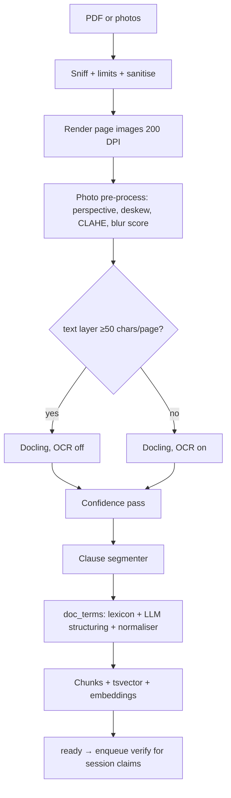

# 05 — Contract Ingestion & Contract Verification Engine

> **Version 0.2.1 — 2026-11-13 (upload-first MVP revision; HC-5 note in 0.2.1).** Original: `_archive/v0.1-2026-11-13/05_…md`.
> **Scope:**
> - [MVP] PDF and **photo upload** (JPEG/PNG/WebP, multi-page, via file picker; on phones it opens the camera). Docling + OCR, OCR confidence pass, clause segmentation, `doc_terms`, chunks, hybrid retrieval (BM25 + vector + RRF), contract engine.
> - [Deferred] custom in-app camera with edge guides and live blur check (Later-L1/UX), reranker (Later-L4), insurance policy wordings (Later-L7).
>
> Doc input decision [Accepted 2026-11-13]: **PDF + photo upload**.

## 1. Purpose
Ingest the KFS, sanction letter, loan agreement or fee schedule, preserving page, clause, bbox and OCR-confidence provenance. Then verify claims against the clauses, producing evidence that conforms to doc 08 §3–§4.

- **Depends on:** docs 01, 04, 08, 09 (retrieval), 11, 12 (upload security).
- **Feeds:** doc 06 (doc terms), doc 08.

## 2. Prerequisites
- Phase 1 claims exist (verification can also run later).
- E5 (OCR on photos) and E6 (retrieval/NLI) must report at HC-4.

## 3. Facts (retrieved 2026-11-13)
- Docling is MIT-licensed. It does layout analysis with bboxes and labels, TableFormer table structure, and page provenance [V].
- Pluggable OCR: RapidOCR, EasyOCR, Tesseract, macOS Vision. Which is the default is disputed [V/conflict].
- Per-word OCR confidence through Docling is **[A] → E5**.
- OCR engine licences are **[A]**; verify at HC-4.

## 4. Inputs
| Kind | Limits |
|---|---|
| PDF (digital or scanned) | ≤ 40 MB, ≤ 60 pages; encrypted PDFs → `400 encrypted_pdf` |
| Photos (JPEG/PNG/WebP; HEIC converted client-side) | ≤ 20 pages per document, ≤ 15 MB each, ordered |
| `kind` (user-selected) | `kfs \| loan_agreement \| sanction_letter \| fee_schedule \| other`. `insurance_policy` is deferred |

## 5. API
- `POST /api/v1/sessions/{id}/documents` (multipart: `kind`, `files[]` in page order; `Idempotency-Key` required) → `202 {document_id, version:1, status:"queued"}`.
  - The dedupe key is sha256 over the ordered page hashes. A duplicate in the session returns `200 {document_id, duplicate:true}`.
- `GET /api/v1/documents/{id}` returns status, pages, `warnings[]` (e.g. `blurry_page`, `low_ocr_page`, `page_unreadable`).
- `GET /api/v1/documents/{id}/pages/{n}/image` (presigned) and `GET /api/v1/documents/{id}/clauses?page=`.
- `PUT /api/v1/documents/{id}/pages/{n}` (replace a photo) → `version+1`, re-ingest, and re-verify with `changed_because=document_replaced`.
- Event `document.status{document_id, version, stage: queued|sanitising|rendering|ocr|confidence|segmenting|indexing|ready|failed, progress, code?, warnings[]}`.

## 6. Ingestion (job `doc.ingest:{document_id}:{version}`)


1. **Sanitise:** pikepdf (strip JS and embedded files); Pillow decode with pixel limits; re-encode images and strip EXIF/GPS. Failure is an `input` error.
2. **Render** WebP page images. Store `width/height`.
3. **Pre-process photos** (OpenCV): perspective, deskew, CLAHE. A Laplacian variance below the threshold adds a `blurry_page` warning ("Retake page N").
4. **Docling** (`do_table_structure=True`, ACCURATE; OCR engine = E5 winner; languages en + hi where supported). Store `docling.json`.
5. **Confidence pass:** use Docling confidences if E5 finds them. Otherwise run Tesseract `image_to_data` on the bboxes of items that contain digits, `%` or `₹`. Store `ocr_conf` and `ocr_min_numeric_conf` per item. Text-layer pages get `1.0` and `text_source=text_layer`. A page with < 50 OCR chars → `page_unreadable` warning.
6. **Clause segmentation:** reading order. New clause at a SECTION_HEADER or numbering regex. **Each table row is its own clause**, with the header row prepended.
7. **doc_terms:** a lexicon pass for KFS fields, then an LLM structured pass mapping clause → `{field, value_raw, unit, basis, rate_type, conditions, includes_gst}`. **`value` comes only from the doc 04 normaliser** (`normaliser_version` recorded). Unparsed → `value=None`.
8. **Chunks** for retrieval (doc 09).
9. **Commit atomically** per `(document_id, version)`. A re-run rewrites that version's rows. When the version reaches `ready`, enqueue `verify:{claim_id}` for every active claim in the session.

**Coordinates:** bboxes are normalised server-side to 0–1 with a top-left origin. Docling's native origin is **[A]**; verify and test.

## 7. Contract engine (`engines/contract`)
```python
class VerificationEngine(Protocol):
    name: Literal["contract","finance","rules","public_data"]
    def applies(self, claim: Claim, ctx: SessionContext) -> bool: ...
    async def verify(self, claim: Claim, ctx: SessionContext) -> EngineVerdict: ...   # doc 08 §3.4
```

1. No ready document → `NOT_VERIFIED(no_document)`.
2. **Candidates:** `doc_terms` by field map (`contract/fieldmap.py`), plus hybrid retrieval (doc 09 §4) top 3. Nothing ≥ `T_ret` → `NOT_VERIFIED(clause_not_found)`. The relevant page unreadable → `NOT_VERIFIED(page_unreadable)`.
3. **Numeric path:**
   - Convert to a common base (percent of loan amount ↔ INR using the document's loan amount, via doc 06 `SourcedFactory`). Cannot convert → `UNCLEAR(incomparable_units)`. Before HC-5 approval, a comparison that needs a formula returns `NOT_VERIFIED(calculation_not_enabled)`. Like-for-like comparisons (percent vs percent, INR vs INR) are not gated (doc 06 §4a).
   - Compare using **doc 06 §Tolerances** (single table; v0.1's ±10% "approx" here is removed).
   - Result: equal → MATCH; outside the rounding band → CONFLICT; within it → `UNCLEAR(possible_rounding)`.
   - **GST:** claim "2%" vs document "2% + GST" → MATCH on the base fee, with an informational note. If the agent said "including everything" or "nothing extra", → CONFLICT on the total, with the GST amount computed by doc 06. If that depends on the assumed GST rate → `UNCLEAR(assumption_dependent)`.
   - **Basis:** flat vs reducing at the same number → CONFLICT on basis (C-CALC-DOC if the cost impact is computed).
4. **Semantic path:** NLI cross-encoder plus an LLM judge (structured label + verbatim clause span). Both contradict → CONFLICT. Both entail → MATCH. Otherwise `UNCLEAR(semantic_disagreement)` [Proposed ADR-006].
5. **Conditions** differ → `UNCLEAR(condition_mismatch)`.
6. **OCR gate:** `ocr_conf < T_ocr` or `ocr_min_numeric_conf < T_ocr_num` → `UNCLEAR(low_ocr_confidence)` with "Upload a clearer photo of page N".
7. **Evidence:** `DocumentEvidence` built **from DB rows only**, plus the claim's `SpokenEvidence`. Reason text from the doc 08 §8 templates.
8. Errors follow doc 01 §6. A final failure → `NOT_VERIFIED(engine_error)`.

## 8. Error handling
| Case | Class | Outcome |
|---|---|---|
| Encrypted PDF / bad image | input | 400/415; no retry |
| Docling timeout (120 s/page) | transient | Retry; then fallback to the simple OCR pipeline once; then `failed` |
| Page unreadable | — | Warning; claims needing it → `NOT_VERIFIED(page_unreadable)` |
| LLM doc_terms schema failure | schema | 1 corrective retry; else the term is skipped (retrieval still works) |

## 9. Testing
- Synthetic agreements (doc 12) × {digital, scanned, phone photo ×3 lighting}.
- E5: per-field numeric accuracy, confidence availability, ingest time.
- Segmentation boundary F1 on 5 documents.
- 200 labelled claim–clause pairs → confusion matrix.
- Idempotency: re-run → identical rows; duplicate upload → same id; page replace → version 2 and re-verify.
- bbox highlight test on rendered images.

## 10. Acceptance criteria (Phase 2 exit)
- Digital PDFs: 100% of key numeric fields correct.
- Good-light photos: ≥ 97% (E5, measured). Bad-light errors surface as UNCLEAR or NOT_VERIFIED, **never CONFLICT** (test).
- Every contract CONFLICT carries page + clause + bboxes, and the highlight lands correctly on 100% of the test set.
- Ingest ≤ 8 s/page p50 on an 8-core CPU (measured in E5; target, not a claim).

## 11. Human review
**HC-4:** E5/E6 report, OCR backend (ADR-013), thresholds, photo guidance text.

## 12. Common failures
- Using the printed page number instead of the physical one. The physical page is primary.
- KFS tables flattened to prose.
- Flagging "2% + GST" vs "2%".
