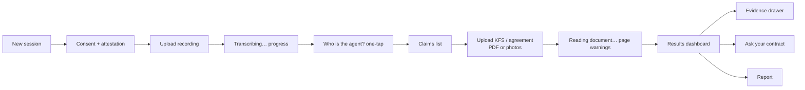

# 10 — React PWA Frontend

> **Version 0.2.1 — 2026-11-13 (upload-first MVP revision; attestation wording in 0.2.1).** Original (live-first design): `_archive/v0.1-2026-11-13/10_…md`.
> **Scope:**
> - [MVP] upload-first flow: consent + attestation → recording upload → speaker confirmation → claims → document upload (PDF/photos) → results dashboard + evidence drawer → report; basic Ask; settings/delete.
> - [Deferred] live screen, recording banner, capture health and in-app camera with edge guides (Later-L1/L2).

## 1. Purpose
A mobile-first, installable PWA that a non-expert customer can use in English or Hindi to check what an agent said against the documents, and to know what to ask before signing.

- **Depends on:** doc 11 (API/events; generated TypeScript types), doc 08 (statuses, wording), doc 03 §5 (speaker confirmation).

## 2. Stack
React 18 + TS + Vite, Tailwind, vite-plugin-pwa, React Router, TanStack Query, Zustand, i18next (en, hi), server-rendered page images with an SVG bbox overlay, `<audio>` for snippets. Types come from `openapi-typescript` (no hand-written duplicates).

## 3. Structure
```
src/app  src/lib/{api.ts, events.ts, format.ts, idempotency.ts}
src/features/
  sessions/        SessionList, NewSession (product type, lender (demo search), language)
  consent/         ConsentScreen, RecordingAttestation        (doc 01 §5)
  recording/       UploadRecording, UploadProgress, StereoMapping
  speakers/        SpeakerConfirm ("Who is the agent?"), SegmentReassign
  transcript/      TranscriptView (timestamps, speaker chips, play)
  claims/          ClaimList, ClaimCard, ConfirmQuote [Proposed HC-3]
  documents/       UploadDocuments (PDF or photos, input capture=environment), PageOrder, IngestProgress, PageViewer, ReplacePage
  results/         ResultsDashboard, ResultCard, EvidenceDrawer, CalcTrace, QuestionsToAsk, StatusChip
  ask/             AskScreen, AnswerBubble, CitationChip            [MVP-limited]
  report/          ReportPreview, Export (PDF), Share
  settings/        Language, DeleteSession, Retention info
src/i18n/{en,hi}.json
```

## 4. MVP flow

- Steps C and G can happen in either order. Results update through `verification.updated` events.
- The speaker confirmation (E) is **prominent but skippable**. If skipped, a banner says "Confirm the agent to enable mismatch checks". Possible conflicts show as "Needs clarification — speaker not confirmed" (doc 08 §5).

## 5. Key screens
- **Consent + attestation:** the full versioned text (en/hi) from `/consent-texts`, then checkboxes per doc 01 §5. The attestation screen is titled "About this recording (your statement)". The `agent_informed` choice shows the legal-caution note.
- **Upload recording:** file picker (audio/*), size/length hints, an optional "each side of the stereo is one person" toggle, a progress bar with resumable retry using the same Idempotency-Key, and a duplicate notice.
- **Speaker confirmation:** for each speaker, 3 quotes with play buttons; "This is the agent" / "Swap"; per-segment fix in the transcript view.
- **Upload documents:** choose kind; `<input type="file" accept="application/pdf,image/*" capture="environment" multiple>`; reorder thumbnails; client-side blur hint (optional); server warnings drive "Replace page N".
- **Results dashboard:** grouped CONFLICT → UNCLEAR → NOT_VERIFIED → MATCH, with counts. The card shows a templated headline, "Agent said: '…' (04:12)", "Document says: '…' (page 3)", and the suggested question. "Updated because …" appears when the version changed.
- **Evidence drawer:**
  - audio snippet (start − 2 s → end + 2 s)
  - quote with a low-confidence hint
  - page image with the highlighted bbox
  - calculation trace with input source badges (agent said / document / assumed)
  - per-engine sub-checks (e.g. "agent's numbers are consistent")
  - speaker badge (confirmed / auto-detected)
- **Report:** summary, all results with evidence, the questions to ask, disclaimers ("Not legal or financial advice"), an attestation note worded as the customer's own statement, e.g. "The customer states the agent was informed of the recording (not independently verified)". It is never worded as agent consent, and the generation time. Exported as server-rendered PDF.
- **Settings:** delete session now (with confirmation) and the retention period shown.

## 6. State and events
- TanStack Query for resources.
- An event reducer patches the cache by `seq`, ignoring duplicates and out-of-order events. After a gap above 500 events, resync via `GET /sessions/{id}/state`.
- Events used: `session.status`, `recording.status`, `transcript.ready`, `speaker.updated`, `claim.created`, `claim.updated`, `document.status`, `verification.updated`, `qa.answer`, `error`.

## 7. Accessibility & inclusion
- 16 px+ text, 44 px tap targets, WCAG AA.
- Status is shown by icon + text, not colour alone.
- Indian number formatting (₹5,00,000 / "5 lakh"); glossary popovers (KFS, APR, flat vs reducing).
- Hindi strings reviewed by a native speaker.
- The **wording lint** (doc 08 §8) runs on `en.json` and `hi.json`.

## 8. PWA
- Installable app shell.
- **No caching of API responses, presigned media or page images.**
- Offline: show "You're offline". Uploads resume through the idempotent retry.

## 9. Testing
- Vitest: reducers, StatusChip/ResultCard for all statuses × reason codes, i18n completeness, wording lint.
- Playwright E2E with fake providers: the full MVP flow, including a skipped speaker confirmation (→ UNCLEAR) and then confirmation (→ CONFLICT with `changed_because`).
- Lighthouse PWA and accessibility ≥ 90.

## 10. Acceptance criteria (Phase 3 exit)
- The MVP flow works end-to-end on Android Chrome and desktop Chrome/Safari/Firefox (upload-only, so it isn't limited to Chromium).
- The evidence drawer plays from the right timestamp (±0.5 s) and highlights the right bbox.
- All four statuses are distinguishable without colour.

## 11. Human review
- UX test with 3–5 target users before Phase 4 exit.
- Copy review (accusation-free) as part of HC-2/HC-8.

## 12. Common failures
- Client-side PDF rendering on low-end phones.
- Caching presigned URLs.
- Hiding the speaker-confirmation step so deeply that users never reach it.

---

## Deferred UI (preserved from v0.1)
- **Later-L1/L2:**
  - live screen with transcript stream and partials
  - persistent red recording banner (pause/stop)
  - capture health per channel
  - Meet tab capability detection
  - claim cards appearing live
  - in-app multi-page camera with edge guides and live blur check
  - Wake Lock
  - MediaRecorder offline backup
- **Later:** read-aloud of headlines (SpeechSynthesis).
