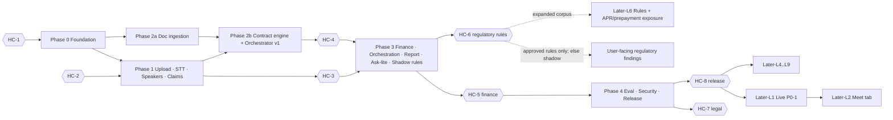

# 13 — Implementation Roadmap & Human Review

> **Version 0.2.2 — 2026-11-13 (HC-1 approval recorded); 0.2.1 — (upload-first MVP revision; HC-6 made explicit, HC-1 scope and HC-5 gate clarified in 0.2.1).** Original: `_archive/v0.1-2026-11-13/13_…md`.
> **Naming change:** phases are now **Phase 0–4** (MVP) and **Later-L1…L9**. "P0-1…P0-4" refers **only** to the four product innovations.
> **HC-1: APPROVED** by the user (project owner) on 2026-11-13. HC-2…HC-8: **pending**. Phase 0 implementation may start. Nothing beyond Phase 0 is authorised.

## 1. P0 innovation tracker
| Innovation | MVP form | Phase | Deferred enhancement |
|---|---|---|---|
| **P0-1 Live Promise Verification** | **Deferred by user decision, 2026-11-13 (ADR-015).** The MVP builds the reusable claim → engines → results pipeline in batch mode | — | Later-L1: live mic, realtime STT, incremental extraction, live re-verification. Later-L2: Meet tab |
| **P0-2 Evidence-Linked Contradictions** | Revision-pinned quote anchors + timestamps; page/clause/bbox; CONFLICT combinations + integrity validator (doc 08 §4); evidence drawer; report | 1 → 2 → 3 | Embedded audio and page crops in the PDF report |
| **P0-3 Hybrid Financial Reasoning** | `SourcedFactory`-only inputs; MVP formula set; calculation traces | 3 | APR, prepayment, penal (gated by HC-5); Later-L6 exposure |
| **P0-4 Uncertainty-Aware Verification** | 4 statuses, canonical reason codes, speaker/ASR/OCR/assumption gates, versioned transitions | 1–3 | Calibrated thresholds (Phase 4); live `awaiting_confirmation` (Later-L1) |

## 2. Phases

### Phase 0 — Foundation
- **Dependencies:** HC-1.
- **Deliverables** (doc 01, doc 11 §2–3 foundation tables, doc 12 B.2 basics):
  - compose
  - auth
  - sessions (upload mode only)
  - consent + attestation
  - events WS
  - job queue with dedupe
  - retry policy
  - error model
  - idempotency keys
  - audit
  - provider protocols (fakes)
  - CI
  - frontend shell
  - `eval/` skeleton
- **Tests:** doc 01 §10.
- **Acceptance:** doc 01 §11.
- **Gates:** HC-1 before start.
- **Exit conditions:**
  - all Phase 0 tests green in CI
  - an upload session reaches `ready` with consent
  - the events WS works
  - Phase 1 datasets started

### Phase 1 — Audio upload, batch STT, speaker attribution, claim extraction
- **Dependencies:**
  - Phase 0
  - HC-2 (claim schema, statuses, evidence policy)
  - ElevenLabs key provided
  - ADR-004 LLM selected (selection eval runs early in this phase)
- **Deliverables:**
  - doc 02 upload pipeline
  - doc 03 batch STT + diarization + auto-role + confirmation API
  - doc 04 extraction + normaliser + anchors
  - doc 08 schemas/enums module (no engines yet; claims get `NOT_VERIFIED(no_document)` with spoken evidence)
  - UI: consent → upload → speaker confirm → transcript → claims
- **Tests:**
  - normaliser table
  - anchor property test
  - idempotency suite (audio)
  - cassette tests
  - E2E with fake providers
- **Experiments:** E2, E3, E10.
- **Acceptance:** doc 02 §8, doc 03 §11, doc 04 §12 (measured).
- **Gates:** HC-2 at start; **HC-3** at exit.
- **Exit conditions:**
  - HC-3 decisions recorded: languages, confirm-quote fallback, fallback provider
  - extraction metrics reported
  - no unanchored quotes

### Phase 2 — Document ingestion & contract verification
- **Dependencies:** Phase 1 claims (ingestion can start in parallel after Phase 0); ADR-005; E5/E6.
- **Deliverables:**
  - doc 05 ingestion for PDF + photos (sanitise, render, OCR, confidence pass, clauses, doc_terms, chunks)
  - doc 09 §3–4 hybrid retrieval
  - contract engine
  - orchestrator v1 (gates, merge, CONFLICT validator, integrity validator, versioning)
  - UI: document upload, page warnings, results dashboard v1, evidence drawer (spoken + document)
- **Tests:**
  - ingestion idempotency
  - bbox highlight
  - 200-pair confusion matrix
  - merge/gate property tests
  - "bad photo never becomes CONFLICT" test
- **Acceptance:** doc 05 §10, doc 08 §12 (pre-calibration).
- **Gates:** **HC-4** at exit (OCR backend, thresholds, retrieval/NLI choice).
- **Exit conditions:**
  - a C-DOC CONFLICT is demonstrated end-to-end on a synthetic recording plus a phone photo
  - HC-4 approved

### Phase 3 — Financial calculations, orchestration & reporting
- **Dependencies:** Phase 2.
- **Deliverables:**
  - doc 06 MVP formulas + `SourcedFactory` + traces + tolerance table
  - gated formulas built but off
  - full primary-comparison table (doc 08 §6)
  - C-CALC-DOC
  - `internal_inconsistency` sub-checks
  - results dashboard v2 (calculation traces, "updated because")
  - report export (PDF)
  - basic Ask with finance routing (doc 09 §5)
  - shadow rules (doc 07 §3)
  - **HC-6 review package (T3.7, completed in this phase)** for the curated rule subset: verbatim quotes, applicability lists, en/hi wording, shadow precision/recall (doc 07 §3). The HC-6 approval itself happens in Phase 4
  - demo lender data (doc 07 §4)
  - finance outputs stay user-hidden until HC-5 approval is recorded (doc 06 §4a)
- **Tests:**
  - golden finance table
  - `UnvalidatedInputError`
  - gated-flag tests
  - routing set
  - citation validator
  - shadow-never-visible
  - report snapshot
- **Acceptance:** doc 06 §9, doc 09 §8, doc 07 §7, doc 10 §10.
- **Gates:** **HC-5** (formulas, tolerances, GST assumption, finance visibility) before exit. Before HC-5, finance runs on synthetic data only and all user-facing finance outputs are disabled (doc 06 §4a).
- **Exit conditions:**
  - the full MVP user flow works with fake and with real providers on the synthetic set
  - the report is generated with evidence

### Phase 4 — Evaluation, security & MVP release readiness
- **Dependencies:** Phase 3.
- **Deliverables:**
  - full eval run and reports (doc 12 A.3)
  - threshold calibration (doc 08 §5) with versioned `thresholds.yaml`
  - perturbation suite
  - security controls and tests (doc 12 B.2)
  - retention/erase jobs and receipts
  - audit completeness
  - accessibility and Hindi copy review
  - UX test with 3–5 users
  - deployment to staging
  - runbook
- **Tests:** everything in doc 12 plus a load test of 20 concurrent uploads.
- **Acceptance:** doc 12 Phase-4 criteria; CONFLICT precision ≥ 0.90 and 0% injected low-confidence → CONFLICT (measured).
- **Gates:**
  - **HC-7** (legal) before any real user
  - **HC-8** (release readiness)
  - **HC-6** (regulatory rules): reviews the Phase 3 rule package. It governs approval of every curated rule **and** every user-facing regulatory finding. Rules remain in shadow mode until HC-6 approves them individually; approval is recorded per rule (`reviewed_by`, `hc6_approved_at`). HC-6 does not block HC-8. If it is not approved, the MVP ships with all rules in shadow. Making an approved rule user-visible is a separate decision recorded at HC-6 (MVP or Later-L6).
- **Exit conditions:** HC-7 and HC-8 approved, with recorded approvers and dates. Until then the MVP may only be used with synthetic or team data.

### Later phases (preserved designs; order to be re-planned after MVP)
| ID | Feature | Source design |
|---|---|---|
| Later-L1 | Live mic recording, realtime STT, incremental extraction, live verification (**P0-1**) | docs 02 D1, 03, 04, 08 §9, 10 |
| Later-L2 | Google Meet tab + mic capture | doc 02 D2 |
| Later-L3 | Meet Media API spike (E8) | doc 02 D3 |
| Later-L4 | Advanced RAG: reranking, query translation | doc 09 |
| Later-L5 | Public lender data automation (RBI lists, scraping with permission) | doc 07 §4 |
| Later-L6 | Expanded regulatory engine and APR/prepayment exposure (HC-5 + HC-6) | docs 06, 07 |
| Later-L7 | Insurance verification (IRDAI research) | doc 04 reserved types |
| Later-L8 | Second STT provider; advanced noise enhancement (E9) | doc 03 |
| Later-L9 | Lender-side / compliance dashboards (Q-7) | — |
| Not planned | Headless-browser bots; cellular call capture (research only) | doc 02 D4 |

## 3. Dependency graph

## 4. Human review checkpoints (HC-1 approved 2026-11-13; HC-2…HC-8 pending)
**HC-6 timing:** T3.7 is **completed in Phase 3** and produces the HC-6 review package. The **HC-6 approval checkpoint occurs in Phase 4**, once that package is ready. HC-6 **does not block HC-8**. Any rule HC-6 has not approved stays in **shadow mode** (never user-visible).

| ID | When | Inputs | Decision |
|---|---|---|---|
| HC-1 ✅ APPROVED 2026-11-13 (user) | Before Phase 0 | Master report v0.2, docs 01–14 v0.2.x, revision reports | Architecture and upload-first scope, specifically ADR-001, ADR-002, **ADR-015** (upload-first MVP, P0-1 live verification deferred — confirm), ADR-016, ADR-017, **ADR-018** (canonical definition owners) and the Proposed ADRs 006/012/014 as written |
| HC-2 | Before Phase 1 code | Doc 04 schema/few-shots; doc 08 taxonomy, reason codes, evidence combinations, wording | Claim and evidence policy |
| HC-3 | Phase 1 exit | E2/E3/E10 reports, pricing | Languages, confirm-quote fallback, ElevenLabs config, fallback provider |
| HC-4 | Phase 2 exit | E5/E6 reports | OCR backend, thresholds, retrieval/NLI, embeddings (ADR-005) |
| HC-5 | Phase 3 exit | Golden table, tolerances, GST, synthetic-data results, APR method (for later) | Finance sign-off; enables user visibility of the MVP formula set only (doc 06 §4a) |
| HC-6 | Phase 4 (after the Phase 3 rule package); required before any rule or regulatory finding is user-visible | Curated rule corpus, verbatim quotes, applicability, wording, shadow metrics | Legal/compliance approval per rule; until then all rules stay shadow |
| HC-7 | Before real users | Consent/attestation texts, privacy notice, retention, legal memo | Pilot go/no-go |
| HC-8 | Phase 4 exit | Eval reports, security results, UX test | MVP release readiness |

**Protocol at each checkpoint:** the implementing agent presents:
1. progress so far
2. what was inspected or measured
3. the options considered
4. a recommendation
5. the exact files or decisions to approve

It then waits. It must not record an approval that wasn't given.

The detailed task breakdown in dependency order is in `revision/MVP_IMPLEMENTATION_PLAN.md`.
