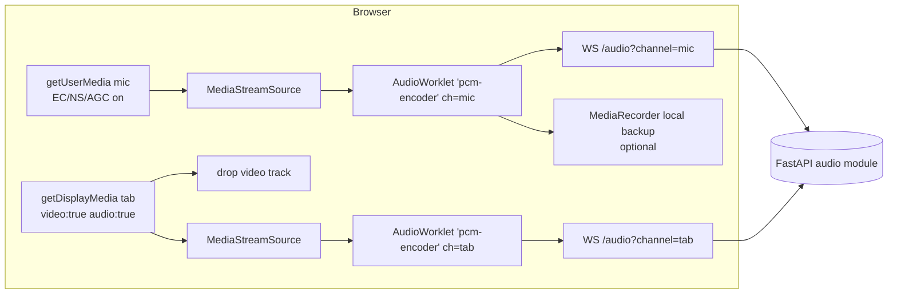

# 02 — Audio Input & Capture (Roadmap P1 upload, P4 live)

## Purpose
Get conversation audio into the backend from three MVP sources, keeping channels separate where possible:
- **A.** In-person PWA microphone.
- **B.** Google Meet tab audio plus the customer's microphone.
- **C.** Recorded upload.

The Google Meet Media API bot is a documented **research spike** (approved decision 2026-11-13).

## Prerequisites
- Doc 01 complete (sessions, consent, WS tickets).
- Experiment E4 (tab capture stability) planned.

## Feasibility summary (retrieved 2026-11-13)

| Mode | Verdict | Evidence |
|---|---|---|
| A. PWA mic | ✅ MVP | `getUserMedia` is universally supported. Constraints `echoCancellation`, `noiseSuppression`, `autoGainControl` [V] |
| B. Meet tab + mic | ✅ MVP, **Chromium desktop only** | Tab audio via `getDisplayMedia` works in Chrome/Edge 74+ only when sharing a **tab** with the audio checkbox ticked. `systemAudio` / `preferCurrentTab` are Chromium-only and experimental [V MDN, Chrome docs] |
| C. Upload | ✅ MVP | Server-side ffmpeg normalisation |
| D. Meet Media API | 🔬 Spike (P9) | Developer Preview. Cloud project, OAuth principal **and all participants** must be enrolled. Restricted audio scope. 3 virtual audio streams carrying the most relevant speakers. Preview terms restrict public apps [V Google docs, Recall.ai] |
| E. Headless browser bot | ❌ Not planned | Workaround only. Joins as a guest, needs host admission, ToS risk, brittle |
| F. Cellular call | ❌ | A browser cannot capture far-end call audio. Speakerphone + mic is the documented fallback; quality warning shown |

## Client architecture

### Decisions [R]
- **Two WebSockets, one per channel.** This is simpler than multiplexing and maps 1:1 to STT connections.
- **AudioWorklet, not MediaRecorder, for streaming.** MediaRecorder yields Opus/WebM containers in chunks that cannot be decoded independently. AudioWorklet gives raw Float32 at the context rate (44.1/48 kHz). We down-sample to **16 kHz mono Int16 LE** in the worklet, using a linear-phase low-pass + decimation (or `OfflineAudioContext`-free polyphase), and send **20 ms frames (640 bytes)** batched to 100 ms (3,200 bytes) per WS binary message.
- **Meet tab: do not apply our own noise suppression.** Meet already does it. Mic: browser NS on (doc 03 §Noise).
- **Do not mix mic and tab client-side.** Channel = speaker role (`mic → customer`, `tab → remote_party`).
- The video track from `getDisplayMedia` is required by the API. Stop it immediately (`track.stop()`) after obtaining audio, then verify that the audio track stays live (E4).

### Capture flows
1. **In-person:** consent screen (customer checkbox + agent read-out script with "Agent agreed" button, plus the option to say the consent aloud so it is recorded) → `getUserMedia({audio:{channelCount:1, echoCancellation:true, noiseSuppression:true, autoGainControl:true}})` → mic WS. Speaker roles are inferred (doc 03 §Speaker).
2. **Meet tab:**
   - Feature-detect `navigator.mediaDevices.getDisplayMedia` and Chromium. Otherwise show "Use Chrome/Edge on a computer or switch to in-person mode".
   - Instructions screen with an image showing "Choose the Meet tab and tick *Share tab audio*".
   - `getDisplayMedia({video:true, audio:{suppressLocalAudioPlayback:false}, selfBrowserSurface:'exclude', surfaceSwitching:'exclude', systemAudio:'exclude', preferCurrentTab:false})`.
   - If `stream.getAudioTracks().length===0`, show "Tab audio not shared — retry and tick Share tab audio".
   - Plus the mic stream, which captures only the customer because Meet's own echo cancellation is separate. Mute our mic channel when the customer mutes? No. Capture it regardless and let VAD handle silence.
3. **Upload:** `POST /api/v1/sessions/{id}/recordings` (multipart). Formats: WAV, MP3, M4A/AAC, WebM/Opus, OGG/Opus, max 200 MB / 3 h. Optional `channel_layout: mono|stereo_split` (stereo where L=customer, R=agent, e.g. from call recorders).

### Recording indicator & lifecycle
- A persistent red banner reads "Recording — SaidSigned is listening", with Pause and Stop.
- The browser's tab-share bar is also visible.
- Pause stops sending frames and inserts a `gap` marker.
- Stop sends `{"type":"end"}` on each WS.
- Page `visibilitychange`: AudioWorklet keeps running when the PWA tab is hidden on desktop. Mobile browsers may suspend it, so show "Keep this screen on" and use the Screen Wake Lock API where available [A → E4].

## Server: audio module

### WS protocol `/ws/sessions/{id}/audio?channel=mic|tab&ticket=…`
- **Client → server:**
  - binary = PCM s16le 16 kHz mono
  - text JSON = `{"type":"start","sample_rate":16000,"encoding":"pcm_s16le","client_ts":…}` | `{"type":"pause"}` | `{"type":"resume"}` | `{"type":"end"}`
- **Server → client:** `{"type":"ack","bytes":N}` every 1 s | `{"type":"level","rms":…}` (optional) | `{"type":"error","code":…}` | `{"type":"closed","reason":…}`.
- **Backpressure:** if the STT upstream lags more than 5 s, the server sends `{"type":"slow_down"}`, and the client buffers locally up to 30 s.

### Handling
1. Validate the ticket, consent, session state `active`, and that the channel is not already open.
2. `AudioStreamWriter` appends PCM to a rolling **segment file every 30 s** in object storage (`audio/{session}/{channel}/{seq:06}.pcm`) and records `audio_chunks_index(start_ms,end_ms,key)`. At session end, the worker concatenates the segments into `{channel}.flac` for playback and batch STT.
3. **VAD gate (Silero VAD, ONNX, CPU):** frames classified as non-speech for more than 2 s are not forwarded to STT. The writer still stores them so timestamps stay continuous. We keep an **offset map** so STT timestamps map back to session time. Cost benefit is assumed [A] and measured in E1.
4. Forward speech frames to `STTProvider.stream()` (doc 03).

### Upload pipeline (worker job `audio.ingest_upload`)
1. Sniff magic bytes (RIFF/WAVE, ID3/MPEG frame sync, `ftyp` M4A, EBML WebM, OggS) → otherwise reject `unsupported_media`.
2. `ffprobe` duration/codec with a 30 s timeout. Reject recordings over 3 h.
3. `ffmpeg -i in -ac 1 -ar 16000 -sample_fmt s16 out.wav`. For `stereo_split`, also extract `-af pan=mono|c0=c0` and `c0=c1` per channel.
4. Optional denoise (doc 03, off by default).
5. Enqueue `stt.batch_transcribe` (doc 03) → transcript → claims.

## Meet Media API spike (P9) — scope
- Enroll the Cloud project and test accounts in the Developer Preview.
- Run Google's TypeScript reference client and confirm that audio arrives as 3 virtual streams with CSRC → participant mapping.
- Measure latency.
- Document whether a non-enrolled participant blocks access (expected: yes).
- **Exit criterion:** a go/no-go memo. **No production code until GA.**

## Error handling
| Case | Behaviour |
|---|---|
| Mic permission denied | Explain and offer upload mode |
| Tab audio track missing | Retry instructions; do not start |
| Track `ended` (user stops sharing) | Emit `session.status{channel:'tab', live:false}`; prompt to re-share |
| WS drop | Client reconnects with a new ticket and resumes; server inserts a gap marker |
| Unsupported browser | Capability matrix message |

## Testing
- Unit: resampler (sine sweep → expected spectrum; no aliasing above 8 kHz), frame sizes, magic-byte sniffing.
- Integration: a fake WS client streams a WAV fixture → stored PCM matches byte-for-byte; the offset map is correct with VAD gating.
- E4 manual: 30-min Meet call, PWA tab hidden, laptop on battery. Check for dropped frames.

## Acceptance criteria
- In Chrome desktop, mic and Meet tab channels stream concurrently for 30 min with under 0.5% frame loss.
- Uploads of the 5 formats normalise to 16 kHz mono WAV, and duration is within ±50 ms.
- Recording indicator always visible; Stop ends both channels within 1 s.

## Human review
- Consent read-out wording (feeds HC-7).
- E4 results before committing P4.

## Common failures
- The user shares a window or screen instead of a tab, so there is no audio.
- Wrong down-sampling (no low-pass) causes aliasing and worse WER.
- Mobile Safari suspends AudioContext on lock. Require user gesture to `resume()`.
- Clock drift between the two channels. Timestamp per-channel from server receive time plus sample count, not client clocks.
