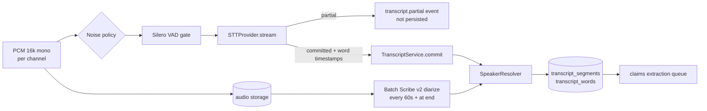

# 03 — ElevenLabs STT & Audio Processing (Roadmap P1 batch, P4 realtime)

## Purpose
Turn audio into timestamped, speaker-attributed transcript segments with confidence. The work sits behind a provider-independent `STTProvider` interface, with ElevenLabs Scribe as the first implementation.

## Prerequisites
- Doc 02 audio module.
- An ElevenLabs API key.
- Experiments E1 (realtime format/latency), E2 (Hinglish), E3 (confidence fields) **must run first**. They decide the values marked [A] below.

## Verified facts (retrieved 2026-11-13)

| Fact | Status |
|---|---|
| Realtime WS `wss://api.elevenlabs.io/v1/speech-to-text/realtime`, query-string params, model `scribe_v2_realtime` | [V] |
| Audio is sent as `input_audio_chunk` messages (base64) | [V, secondary] |
| Events: `partial_transcript`, `committed_transcript`, `committed_transcript_with_timestamps` | [V] |
| Commit strategy: `manual` (default) or `vad` (silence secs, threshold, min speech ms). `turn_prediction` mentioned in a newer reference | [V], defaults conflict → E1 |
| Keyterms supported (~50 realtime) | [V, secondary] |
| **No realtime diarization** | [V, secondary] |
| Batch Scribe v2 supports diarization | [V] |
| Realtime price ≈ $0.39/hr (vendor) vs $0.28/hr (third party) | conflict → HC-3 |
| Exact PCM encoding enum and sample rates | [A] → E1 |
| Hindi/Hinglish quality | [A] → E2 |
| Word-level confidence/logprob | [A] → E3 |

Sources: master report §22.

## Pipeline



## Interfaces
```python
class WordToken(BaseModel):
    text: str; start_ms: int; end_ms: int
    confidence: float | None          # normalised 0..1; None if provider gives none
    speaker_label: str | None = None  # provider diarization label (batch only)

class CommittedSegment(BaseModel):
    provider_segment_id: str | None
    channel: Literal["mic","tab","upload","upload_L","upload_R"]
    text: str
    start_ms: int; end_ms: int        # SESSION time (after VAD offset mapping)
    words: list[WordToken]
    language: str | None              # e.g. "hi", "en"
    avg_confidence: float | None
    min_numeric_confidence: float | None   # min over tokens containing digits/number words

class PartialSegment(BaseModel):
    channel: str; text: str; start_ms: int

class STTStreamConfig(BaseModel):
    sample_rate: int = 16000
    language_hint: str | None = None   # None => auto-detect (Hinglish)
    keyterms: list[str] = []
    commit_strategy: Literal["vad","manual"] = "vad"
    vad_silence_secs: float = 0.8      # [A] tune in E1 (sentence ends faster than 1.5s default)

class STTProvider(Protocol):
    name: str
    async def stream(self, cfg: STTStreamConfig, audio: AsyncIterator[bytes]
        ) -> AsyncIterator[PartialSegment | CommittedSegment]: ...
    async def transcribe_file(self, key: str, *, diarize: bool, num_speakers: int | None,
        language_hint: str | None, keyterms: list[str]) -> list[CommittedSegment]: ...
```

## ElevenLabs adapter — implementation steps
1. **`ElevenLabsRealtime.stream()`**
   - Open the WS with header `xi-api-key` and query `model_id=scribe_v2_realtime`, `audio_format=<E1 value, expected pcm_16000>`, `commit_strategy=vad`, VAD params, `include_timestamps=true`, `language_code` (only if forced), and keyterms.
   - Read the **current** API reference at build time and pin the values in `config/stt_elevenlabs.yaml` with the date verified.
2. **Sender task:** for each 100 ms PCM chunk, send `{"message_type":"input_audio_chunk","audio_base_64":…, "sample_rate":16000}` (field names per E1). On `end`, send a final commit and close.
3. **Receiver task:** map `partial_transcript` → `PartialSegment`. Map `committed_transcript_with_timestamps` (preferred) or `committed_transcript` → `CommittedSegment`. Convert provider times to session time with the VAD offset map from doc 02.
4. **Reconnect:** on unexpected close, reconnect within 1 s with exponential backoff (max 5). Audio buffered during reconnect (≤30 s) is replayed. Emit `error{code:"stt_reconnecting"}` and then `session.status{stt:"ok"}`.
5. **Keyterms** (≤50): lender name, product name and a fixed list:
   - "processing fee", "foreclosure", "prepayment", "part payment", "KFS", "APR", "EMI", "flat rate", "reducing balance", "GST", "insurance", "lakh", "crore", "moratorium", "penal charges".
6. **`ElevenLabsBatch.transcribe_file()`:** POST to the Scribe v2 batch endpoint with `diarize=true`, `num_speakers` (2 for in-person), and timestamps at word granularity. Parse words with `speaker_id`. Long files use async/webhook mode if the API offers it [A].
7. **Confidence normalisation:** if the provider returns logprob, set `confidence = exp(logprob)`. If it returns nothing, set `None`. **`None` is treated as low confidence for numeric tokens** in P0-4 gating, so a missing confidence never produces `CONFLICT` by default. E3 decides whether `None` is the realtime norm. If it is, use the batch re-pass to fill confidences before any realtime `CONFLICT` is emitted. Until then the realtime result is shown as `UNCLEAR (awaiting confirmation)`.

## Speaker identification (no realtime diarization)

| Mode | Strategy | Label shown |
|---|---|---|
| Meet tab | channel `tab` → `agent`, channel `mic` → `customer` | Agent / You |
| Upload stereo split | L/R per user mapping | Agent / Customer |
| Upload mono | batch diarization → `spk_0/1` → role assignment (below) | Agent / Customer (auto) |
| In-person single mic | realtime: `SpeakerResolver` infers role per segment; batch diarization every 60 s corrects it | "Agent (inferred)" until confirmed |

**Role assignment for diarized labels [R]:**
1. Score each speaker label with the LLM role classifier over its first 60 s of text ("who is selling a loan?"), plus heuristics (product pitching, quoting rates).
2. Pick the assignment with the highest total.
3. Show a one-tap "Swap speakers" control.
4. A user correction overrides everything and triggers re-verification.

**Realtime inference for single mic [R]:** per committed segment, the LLM classifier labels `agent|customer|unknown` with a confidence (batched with claim extraction to save calls). Any claim from an `inferred` role is limited to at most `UNCLEAR` until batch diarization or the user confirms the speaker. Agent-attributable `CONFLICT`s therefore always rest on confirmed attribution.

## Noise policy [R]
| Source | Default | Option |
|---|---|---|
| Live mic | Browser WebRTC NS/EC/AGC | RNNoise-WASM toggle if E9 shows benefit |
| Meet tab | None (Meet already processes) | — |
| Uploads | Loudness normalisation only (`ffmpeg loudnorm`) | DeepFilterNet 3 offline, behind a flag, only if E9 shows WER gain |

**E9 protocol:** 30 clips × {clean, café noise 10 dB SNR, fan 5 dB SNR} × {none, WebRTC, RNNoise, DeepFilterNet}. Measure WER and numeric-token accuracy. Adopt a denoiser only if it improves numeric accuracy by at least 2 points and does not hurt clean audio.

## VAD — is it worth it?
- **Benefits:** fewer seconds streamed (cost [A]), fewer empty commits, and cleaner segment boundaries for claim extraction.
- **Risk:** clipping word onsets. Mitigate with 300 ms pre-roll and 500 ms hang-over.
- **Decision:** enable the server Silero gate for silences over 2 s only. ElevenLabs VAD handles segmentation within speech.

## Persistence
- `transcript_segments(id, session_id, channel, speaker_role, speaker_source: channel|inferred|diarized|user, speaker_confidence, text, start_ms, end_ms, language, avg_conf, min_numeric_conf, provider, provider_segment_id, revision)`.
- `transcript_words(segment_id, idx, text, start_ms, end_ms, confidence, speaker_label)`.
- Batch re-pass **does not overwrite** text silently. It writes a new `revision`. If text changed in a span that a claim quotes, that claim is re-extracted and re-verified, and `claim.updated` is emitted.

## Error handling
| Case | Behaviour |
|---|---|
| 401/403 from ElevenLabs | `provider_unavailable`; session continues recording; batch later |
| 429 / quota | Backoff; fall back to record-only + batch at end; UI banner "Live checking paused" |
| Language mis-detect (e.g. Urdu script output) | If E2 shows issues, force `language_code` from session hint |
| Empty commits | Drop if text is blank |

## Testing
- Unit: offset mapping, confidence normalisation, speaker resolver (fixtures).
- Contract test: a recorded ElevenLabs WS session (cassette) replays → identical segments.
- **E1:** 20 English + 20 Hinglish utterances over a live connection from India. Record the partial → committed latency p50/p95.
- **E2:** 30 scripted clips. Measure WER (en), CER + numeric-token accuracy (Hinglish), with transcripts hand-labelled.
- **E3:** check fields returned in realtime vs batch.

## Acceptance criteria
- Realtime: committed segment p50 ≤ 1.5 s after end of speech (E1).
- Numeric-token accuracy ≥ 95% on the E2 set, or a documented mitigation such as forcing batch confirmation.
- Single-mic diarized role assignment correct on ≥ 90% of 2-speaker test clips.
- Provider swap: a `FakeSTTProvider` passes the same integration tests.

## Human review
**HC-3:** E1–E3 report, pricing confirmation, go/no-go on ElevenLabs as primary, and the need for a fallback provider (ADR-003).

## Common failures
- Sending 48 kHz audio labelled as 16 kHz produces chipmunk audio and garbage text.
- Using `partial_transcript` for claims causes flickering, duplicate claims. **Never verify partials.**
- Forgetting VAD offsets puts timestamps out of sync with the audio player.
- Hindi numbers transcribed as Devanagari digits or words. Normalisers must handle "५", "पांच", "paanch" (doc 04).
