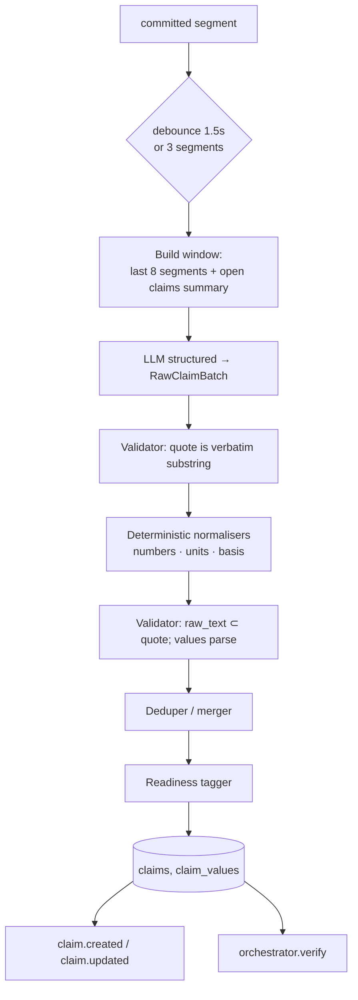

# 04 — Transcript & Claim Extraction (Roadmap P1, incremental mode in P4)

## Purpose
Turn transcript segments into **structured, verifiable claims**. Each claim keeps the exact quote, speaker, timestamps, normalised values, conditions and confidence. Questions, hypotheticals and customer speech must never be treated as agent promises.

## Prerequisites
- Doc 03 (segments with speaker roles and confidence).
- `LLMProvider` with structured (JSON-schema) output. The provider is chosen in ADR-004.
- HC-2 approval of this schema.

## LLM provider interface (provider-agnostic)
```python
class LLMProvider(Protocol):
    name: str
    async def structured(self, *, system: str, messages: list[dict], schema: type[BaseModel],
                         temperature: float = 0.0, max_tokens: int = 2000,
                         timeout_s: float = 20) -> BaseModel: ...
    async def text(self, *, system: str, messages: list[dict], **kw) -> str: ...
```

**Requirements for any adapter:**
- Native JSON-schema / tool-call structured output.
- Temperature 0.
- Retry once with the validation error appended if Pydantic fails.
- Log prompt id and version, never raw PII (doc 12).

## Schemas
```python
class ClaimType(StrEnum):
    # loans (MVP)
    PROCESSING_FEE="processing_fee"; INTEREST_RATE="interest_rate"; EMI="emi"; TENURE="tenure"
    LOAN_AMOUNT="loan_amount"; NET_DISBURSEMENT="net_disbursement"; PREPAYMENT_CHARGE="prepayment_charge"
    PENAL_CHARGE="penal_charge"; INSURANCE_BUNDLED="insurance_bundled"; OTHER_CHARGE="other_charge"
    TOTAL_COST="total_cost"; DOCUMENT_ASSURANCE="document_assurance"   # "it's all in the paper"
    GENERAL_ASSURANCE="general_assurance"                               # "no hidden charges"
    # insurance (reserved, phase 2 — schema-ready, extractor disabled by flag)
    COVERAGE="coverage"; EXCLUSION="exclusion"; WAITING_PERIOD="waiting_period"
    PREMIUM="premium"; CLAIM_SETTLEMENT="claim_settlement"

class UtteranceKind(StrEnum):
    PROMISE="promise"; ASSERTION="assertion"; CONDITIONAL="conditional"
    HYPOTHETICAL="hypothetical"; QUESTION="question"; OPINION="opinion"
    CUSTOMER_STATEMENT="customer_statement"

class Quantity(StrEnum):
    AMOUNT_INR="amount_inr"; PERCENT="percent"; MONTHS="months"; YEARS="years"; COUNT="count"; BOOLEAN="boolean"

class RateBasis(StrEnum):
    REDUCING="reducing"; FLAT="flat"; UNSPECIFIED="unspecified"

class ExtractedValue(BaseModel):
    field: str                       # e.g. "processing_fee", "interest_rate_annual", "tenure"
    raw_text: str                    # verbatim substring of quote, e.g. "do percent"
    quantity: Quantity
    value: Decimal | None            # normalised by deterministic normaliser, NOT by LLM
    value_low: Decimal | None = None # ranges "10 to 12 percent"
    value_high: Decimal | None = None
    comparator: Literal["eq","lte","gte","approx"] = "eq"   # "under 1%", "around 9k"
    period: Literal["annual","monthly","one_time","per_instance","unspecified"] = "unspecified"
    rate_basis: RateBasis | None = None
    of_what: str | None = None       # "of loan amount", "of outstanding principal"
    includes_gst: bool | None = None

class Condition(BaseModel):
    text: str                        # verbatim
    kind: Literal["if_customer_does","if_eligibility","time_bound","product_variant","other"]

class Claim(BaseModel):
    id: UUID
    session_id: UUID
    claim_type: ClaimType
    utterance_kind: UtteranceKind
    speaker_role: Literal["agent","customer","unknown"]
    speaker_source: Literal["channel","inferred","diarized","user"]
    normalized_statement: str        # "Processing fee is 0% of loan amount"
    quote: str                       # MUST equal transcript text[span]
    source_segment_ids: list[UUID]
    quote_span: tuple[int,int]       # char offsets in concatenated window text
    start_ms: int; end_ms: int
    values: list[ExtractedValue] = []
    conditions: list[Condition] = []
    vagueness: Literal["specific","approximate","vague"]
    extraction_confidence: float     # model self-report, used only as a weak signal
    asr_confidence: float | None     # min word confidence over quote (computed, not LLM)
    readiness: Literal["checkable_now","needs_document","needs_info"]
    supersedes_claim_id: UUID | None = None
    verifiable: bool                 # computed: agent & kind in {promise,assertion,conditional}
```

## Extraction pipeline



### Steps
1. **Window builder.**
   - Concatenate the last 8 committed segments as `[seg:<id> | <role>(<source>) | <mm:ss>] text`.
   - Add a compact list of existing claims (id, type, normalized statement) so the model can emit `supersedes_claim_id` for refinements ("actually it's 1.5%, not 2").
   - Include only segments not already fully processed, plus 2 segments of left context.
2. **Prompt** (versioned as `prompts/claim_extract_v1.md`). Rules given to the model:
   - Extract only statements **about the loan's terms** made by any speaker. Label the speaker and utterance kind; do not decide verifiability.
   - The `quote` must be copied exactly from one segment, or contiguous segments, with segment ids and char offsets.
   - Never compute or infer numbers. Copy `raw_text` exactly ("do percent", "nau hazaar aath sau"). Leave `value` null; the code fills it.
   - Mark examples ("suppose you take 10 lakh…"), questions ("is there any fee?") and customer statements correctly.
   - Mark puffery/vague ("very low", "best rate", "no hidden charges") as `vagueness=vague`.
   - Capture conditions ("if you take our insurance", "for salaried customers", "this month only").
   - Few-shot examples: 12 English + 12 Hinglish, including traps (hypotheticals, questions, corrections, customer echoing the agent: "zero fee, right?" → question).
3. **Verbatim validator.** Map `quote_span` back to segments. Require `quote == window_text[span]` after Unicode NFC and whitespace normalisation. On failure, attempt fuzzy re-anchoring (rapidfuzz partial ratio ≥ 95 within cited segments). If that also fails, drop the claim and log `quote_not_verbatim`.
4. **Normalisers** (pure Python, `claims/normalize.py`):
   - Numbers: digits, Indian grouping ("1,50,000"), words in English and Hindi/Hinglish roman and Devanagari (ek, do, teen … sau, hazaar, lakh, crore; "dedh"=1.5, "dhai"=2.5, "sava"=+0.25, "saadhe"=+0.5), Devanagari digits.
   - Zero synonyms: "zero", "no", "nil", "free", "nothing", "koi nahi", "bilkul nahi" → 0 for fee claims with `quantity=boolean/amount`.
   - Units: "%", "percent", "pratishat", "takka" → PERCENT; "k"/"thousand"/"hazaar" multipliers; "per month"/"mahina" → monthly; "saal"/"years" → YEARS → months.
   - Basis: "flat", "fixed flat" → FLAT; "reducing", "diminishing", "on balance" → REDUCING. "Fixed rate" is **not** flat. It means a non-floating rate type, stored as `rate_type=fixed`.
5. **Deduper.** Two claims are duplicates if they have the same `claim_type`, overlapping values (within 1%), and the same speaker within 120 s. Keep the earliest quote and link others as `also_said_at`. A **contradictory restatement by the agent** (2% then 0%) becomes a new claim with `supersedes_claim_id`. The UI shows both, which is itself useful evidence.
6. **Readiness tagger** (rules):
   - `checkable_now`:
     - EMI/total-cost claims with enough inputs (amount + rate + tenure said anywhere in the session)
     - rule-checkable claims (prepayment charge on a floating personal loan)
     - lender-identity claims
   - `needs_document`: any claim with a corresponding contract field when no document has been ingested yet.
   - `needs_info`: missing inputs. Store `missing_inputs:["tenure"]` and generate a suggested question ("Ask: for how many months?").
7. **Verifiability:** `verifiable = speaker_role=='agent' and utterance_kind in {promise, assertion, conditional}`. A role of `unknown` or `inferred` is allowed but caps the status (doc 08).
8. **ASR confidence** is computed from `transcript_words` covering the quote span. `min_numeric_confidence` is computed over tokens in `values[].raw_text`.

## Batch mode (uploads)
Same pipeline, sliding over the full transcript with windows of 8 segments and stride 6. A second "consolidation" pass merges duplicates across windows.

## API / events
- `GET /api/v1/sessions/{id}/claims?verifiable=true`
- `PATCH /api/v1/claims/{id}` `{speaker_role?, dismissed?: bool, user_note?}`. User corrections are audited and trigger re-verification.
- Events: `claim.created`, `claim.updated` (payload = Claim minus internal fields).

## Error handling
| Case | Behaviour |
|---|---|
| LLM timeout / 5xx | Retry ×2. Then mark window `pending_extraction` and retry in 10 s; live UI shows "catching up" |
| Schema invalid twice | Drop window results, log with prompt version, alert in eval dashboard |
| Normaliser cannot parse | `value=None`, claim kept with `vagueness=approximate`, status capped at UNCLEAR |

## Testing / evaluation
- **Unit:** normaliser table of 300+ cases, including Hinglish and Devanagari; dedupe; readiness.
- **Claim eval set:** 30 scripted conversations (doc 12), hand-labelled claims (type, kind, speaker, values). Metrics:
  - precision/recall per claim type
  - utterance-kind accuracy (especially `hypothetical` and `question` false positives)
  - value exact-match rate
- **Regression:** prompt versions are compared on the eval set before switching.

## Acceptance criteria
- Agent financial claims: precision ≥ 0.85, recall ≥ 0.80.
- Hypotheticals and questions misclassified as promises: ≤ 5%.
- 100% of stored quotes are verbatim substrings (enforced, so a test asserts it).
- Normaliser exact-match: 100% on the unit table.

## Human review
**HC-2:** the claim types list, utterance-kind definitions, "vague" policy, and the 24 few-shot examples.

## Common failures
- The LLM "helpfully" converts "do percent" to 2. That is allowed only in `normalized_statement`; values must come from the normaliser.
- Treating a customer echo ("zero fee na?") as an agent promise.
- Treating "fixed" as "flat".
- Windows too small miss conditions said in the next sentence. Keep 2 segments of right context on re-extraction.
