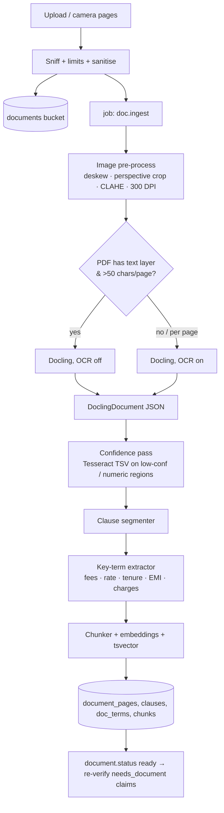

# 05 — Contract Ingestion & Contract Verification Engine (Roadmap P2)

## Purpose
Ingest the loan agreement, KFS, sanction letter or a **phone photo of a printed form**. Preserve page, clause, bbox and OCR-confidence metadata. Verify claims against clauses and produce evidence-linked verdicts (P0-2) gated by OCR confidence (P0-4).

## Prerequisites
- Doc 01 (storage, jobs) and doc 04 (claims).
- `EmbeddingProvider` (doc 09).
- **Experiment E5** (OCR on phone photos) decides the OCR backend.

## Verified facts (retrieved 2026-11-13)
- Docling (MIT licence) converts PDF and images to `DoclingDocument`. It runs layout analysis (elements with bounding boxes and labels such as TEXT, TABLE, SECTION_HEADER), uses **TableFormer** for table structure, and records **provenance including page numbers** [V].
- OCR engines are pluggable: RapidOCR (default in recent versions per one source; conflicting), EasyOCR, Tesseract (CLI/tesserocr), and macOS Vision [V, defaults conflict → E5].
- Licences of the individual OCR engines are not verified [A]. Tesseract is Apache-2.0 per common knowledge, but this must be checked.
- Per-word OCR confidence exposure through Docling's API is **not confirmed** [A → E5].

## Inputs accepted
- PDF (digital or scanned): ≤ 40 MB, ≤ 60 pages.
- Images (JPEG, PNG, HEIC→JPEG client-side, WebP): ≤ 20 pages per document, captured as a **multi-page camera session** in the PWA.
- Document kinds (user-selected, auto-suggested): `kfs | loan_agreement | sanction_letter | fee_schedule | insurance_policy (phase 2) | other`.

## Ingestion flow



### Steps
1. **Sanitise:**
   - PDF: reject encrypted files (ask for the password-free copy), strip JavaScript and embedded files with `pikepdf`, and re-save.
   - Images: decode with Pillow under `Image.MAX_IMAGE_PIXELS` and re-encode to strip EXIF/GPS.
2. **Render page images** at 200 DPI (`pypdfium2`). Store them as `documents/{doc}/pages/{n}.webp` for the UI viewer and highlights.
3. **Pre-process photos** (OpenCV):
   - largest-quadrilateral perspective correction
   - deskew via Hough or minAreaRect
   - CLAHE contrast
   - binarise only for the OCR copy
   - blur check (variance of Laplacian < threshold → `quality_warning: blurry`, "Retake page 2")
4. **Docling conversion:** `PdfPipelineOptions(do_ocr=<per-page decision>, do_table_structure=True, table_structure_options.mode=ACCURATE, ocr_options=<E5 winner>, ocr lang=["en","hi"] where supported)`. Export JSON and keep it as `documents/{doc}/docling.json` (source of truth for provenance).
5. **Confidence pass (P0-4):**
   - If Docling exposes per-cell/word confidence (E5), use it.
   - Otherwise, for every text item containing digits or `%`/`₹`, crop its bbox from the page image and run Tesseract `image_to_data` (TSV gives per-word `conf`).
   - Record `ocr_confidence` (0–1) per text item and `min_numeric_conf`.
   - Digital-text-layer pages get confidence 1.0 and source `text_layer`.
6. **Clause segmentation** (`documents/clauses.py`):
   - Walk Docling items in reading order.
   - A new clause starts at SECTION_HEADER, or at a paragraph matching numbering regexes (`^\(?\d+(\.\d+)*[\).]?\s`, `^\([a-z]\)`, `^Clause \d+`, `^Schedule [A-Z0-9]+`).
   - Each **table row** becomes its own clause, with the header row prepended ("Processing fee | 2% of loan amount + GST"). This matters because KFS documents are mostly tables.
   - Clause record: `{id, document_id, page_start, page_end, bboxes[{page,x0,y0,x1,y1}], section_path, label, text, text_source: text_layer|ocr, ocr_confidence, min_numeric_conf, is_table_row}`.
7. **Key-term extraction:**
   - First a deterministic regex/lexicon pass over clauses for known KFS fields: "processing fee", "rate of interest", "annual percentage rate", "EMI", "tenure", "foreclosure/prepayment", "penal charges", "insurance premium", "documentation charges", "stamp duty", "bounce charges".
   - Then an LLM structured pass that turns each candidate clause into `DocTerm{field, value_raw, value (normaliser), unit, basis, conditions, clause_id}`.
   - Values come from the doc 04 normaliser, never the LLM.
8. **Chunks** for RAG (doc 09): clause-aligned, 300–500 tokens, `tsv` and `embedding`.

## Contract verification engine
```python
class VerificationEngine(Protocol):
    name: Literal["contract","finance","rules","public_data"]
    def applies(self, claim: Claim, ctx: SessionContext) -> bool: ...
    async def verify(self, claim: Claim, ctx: SessionContext) -> EngineVerdict: ...   # schema in doc 08
```

**`ContractEngine.verify(claim)`:**
1. If no document is ready → `NOT_VERIFIED(reason_code="no_document")`.
2. **Candidate clauses:**
   - (a) `doc_terms` where `field` maps from `claim_type` (mapping table in `contract/fieldmap.py`), plus
   - (b) hybrid retrieval (doc 09) with query = `normalized_statement` + synonyms, top 8 → rerank → top 3.
3. If there is no candidate with score ≥ `T_ret` → `NOT_VERIFIED(reason_code="clause_not_found", searched_terms=[…])`. The UI shows "We could not find this in the document. Ask the agent to show where it is written."
4. **Numeric path** (claim has values and the doc term has values; same field):
   - Normalise both to a comparable base: a percent of the loan amount vs an INR amount is converted using the loan amount from the doc. If the base is unknown → UNCLEAR `incomparable_units`.
   - Compare with tolerance. Percent: `abs ≤ 0.05pp`. INR: `≤ max(₹1, 0.5%)`. `approx` comparator: ±10%. `lte`/`gte` compare directionally.
   - Equal → candidate MATCH. Different → candidate CONFLICT.
   - GST nuance: if the claim says "2%" and the doc says "2% + GST" → **MATCH on base fee** plus an informational note "GST of 18% applies on fees [A: rate to verify]". This is not a conflict unless the agent explicitly said "including GST" or "nothing extra".
   - Rate basis: if the claim is FLAT and the doc is REDUCING (or vice versa) with the same number → CONFLICT on basis, with an explanation of the cost difference from the finance engine.
5. **Semantic path** (no numbers, e.g. "no foreclosure charges", "insurance is optional", "everything is in the agreement"):
   - NLI over (clause text → premise, normalized claim → hypothesis) with a multilingual NLI cross-encoder [R ADR-006], **and**
   - an LLM judge with a structured `{label: entails|contradicts|neutral, clause_span: [start,end], rationale}`. The span must be verbatim.
   - Both contradict → candidate CONFLICT. Both entail → MATCH. Otherwise UNCLEAR `semantic_disagreement`.
6. **Conditions:** if the claim has conditions ("zero fee if you take insurance") and the clause states a different condition or none, the verdict is UNCLEAR `condition_mismatch`, and the condition is shown side by side.
7. **Confidence gate** (P0-4): candidate CONFLICT/MATCH degrade to UNCLEAR if the clause `min_numeric_conf < T_ocr_num` (default 0.80 [A]) or the clause `ocr_confidence < T_ocr` (0.70). Reason `low_ocr_confidence` plus "Please retake page N".
8. **Evidence:** emit `DocumentEvidence{document_id, page, clause_id, bboxes, clause_text (copied from DB), ocr_confidence, text_source}`, plus the `SpokenEvidence` from the claim. The reason text is template-generated, not free LLM text:
   - `"Agent said {claim.values} ({quote}, at {mm:ss}). Page {p}, {section_path} says: \"{clause_excerpt}\"."`

## API
- `POST /api/v1/sessions/{id}/documents` (multipart; `kind`, files[] as pages in order) → `{document_id, status:"queued"}`
- `GET /api/v1/documents/{id}` (status, pages, quality warnings)
- `GET /api/v1/documents/{id}/pages/{n}/image` (presigned redirect)
- `GET /api/v1/documents/{id}/clauses?page=n`
- `POST /api/v1/documents/{id}/pages/{n}/retake` (replace page image, re-ingest)
- Events `document.status{stage: queued|preprocessing|ocr|segmenting|indexing|ready|failed, progress, warnings[]}`

## Error handling
| Case | Behaviour |
|---|---|
| Encrypted PDF | `400 encrypted_pdf` + UI instruction |
| OCR produced < 50 chars on a page | Warning "page N unreadable", page excluded, claims needing it → NOT_VERIFIED |
| Docling crash/timeout (120 s/page) | Retry once with OCR-only simple pipeline; then `failed` |
| Mixed-language clause | Normal; FTS uses `simple` config |

## Testing
- Synthetic agreements (doc 12): 10 variants × {digital PDF, printed + scanned, phone photo under 3 lighting conditions}.
- **E5:** field-level accuracy for 15 key numeric fields per backend; confidence availability; ingest time per page on CPU.
- Clause segmentation: gold clause boundaries on 5 documents, boundary F1.
- Contract engine: 200 labelled claim–clause pairs → confusion matrix per status.

## Acceptance criteria
- Digital PDFs: 100% of numeric key fields correct.
- Phone photos (good light): ≥ 97% numeric field accuracy. Bad light: errors must surface as UNCLEAR, never as CONFLICT.
- Every CONFLICT carries page + clause + bbox. The UI highlight lands on the right region in 100% of the test set.
- Ingest ≤ 8 s/page p50 on an 8-core laptop CPU (E5 to confirm).

## Human review
**HC-4:** E5 report (OCR backend, photo guidance, thresholds).

## Common failures
- Treating KFS tables as prose loses the row/column association. Use row-clauses.
- "2% + GST" flagged as a conflict with "2%". Handled by the GST rule.
- A page number from the PDF's printed footer vs the physical page index. **Always use the physical index**, and show the printed number as secondary.
- Retrieval returns a generic definition clause instead of the schedule of charges. Boost `doc_terms` and table rows.
