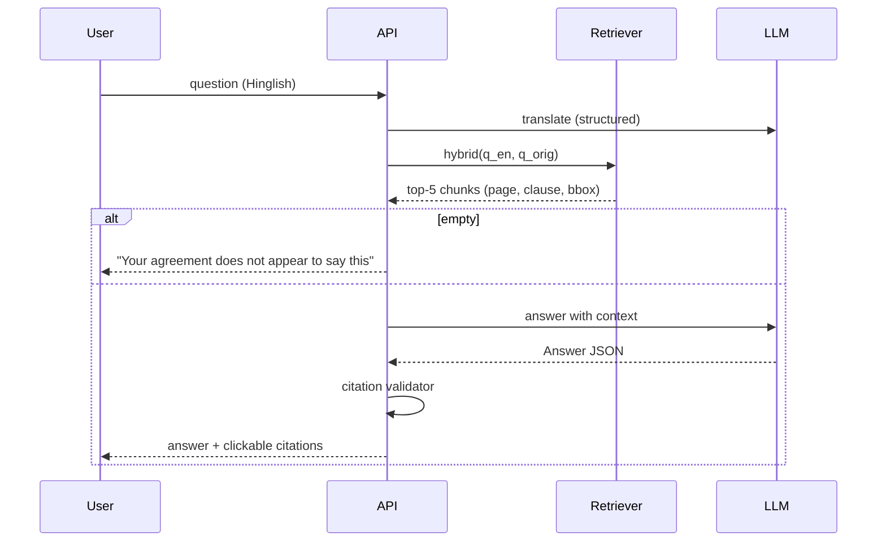

# 09 — RAG & "Ask Your Contract" (Roadmap P6; retrieval core built in P2)

## Purpose
- Let the customer ask questions about their uploaded agreement, in English, Hindi or Hinglish, and get answers **grounded only in retrieved clauses with validated citations**.
- Provide the hybrid retrieval that the contract engine (doc 05) also uses.

## Prerequisites
- Doc 05 (clauses, chunks with page/bbox).
- `EmbeddingProvider`.
- ADR-005 (embedding/reranker models).

## Interfaces
```python
class EmbeddingProvider(Protocol):
    name: str; dim: int
    async def embed(self, texts: list[str], *, kind: Literal["query","passage"]) -> list[list[float]]: ...

class Reranker(Protocol):
    async def rerank(self, query: str, passages: list[str]) -> list[float]: ...

class RetrievedChunk(BaseModel):
    chunk_id: UUID; clause_id: UUID; document_id: UUID; page: int; text: str
    bm25_rank: int | None; vec_rank: int | None; rrf: float; rerank: float | None
```

## Model choice [R → ADR-005, decide at HC-1/HC-4]
- **Embeddings:** a multilingual model is needed because queries are in Hinglish/Hindi and documents in English.
  - Option A: a self-hosted open multilingual model (e.g. a BGE-M3 or multilingual-E5 class model; CPU-feasible for small documents).
  - Option B: the LLM vendor's embedding API.
  - Store `embedding_model` and `dim` per chunk so a model can be swapped by re-indexing.
- **Reranker:** an optional multilingual cross-encoder. Skip it if E6 shows RRF alone reaches Recall@5 ≥ 0.9.

## Indexing
- `chunks(id, document_id, clause_id, page, section_path, text, tokens, tsv tsvector GENERATED ALWAYS AS (to_tsvector('simple', text)) STORED, embedding vector(D), embedding_model)`.
- Indexes: `GIN(tsv)`, `HNSW (embedding vector_cosine_ops)`, `btree(document_id)`.
- Chunking: one clause = one chunk if it is ≤ 500 tokens. Otherwise split on sentence boundaries with a 50-token overlap. Prepend `section_path` and the table header to the chunk text for context.

## Retrieval (shared by contract engine and Q&A)
1. **Query expansion (deterministic):** a domain synonym map, e.g.
   - "foreclosure" ↔ "prepayment" ↔ "part-payment" ↔ "closing early" ↔ "jaldi band"
   - "processing fee" ↔ "login fee" ↔ "file charge"
   - "EMI" ↔ "kist" ↔ "instalment"
2. **Optional LLM translation:** if the query is Hindi/Hinglish, the LLM translates it to English (structured: `{english_query}`). Both versions are used.
3. **BM25-ish:** `ts_rank_cd(tsv, websearch_to_tsquery('simple', q))` top 20 within the session's documents only.
4. **Vector:** cosine top 20 within the session's documents only.
5. **RRF:** `score = Σ 1/(60 + rank)`. Boost +0.02 for `doc_terms`-linked clauses and table rows when the query mentions money or rates.
6. **Rerank** top 20 → top 5 (if enabled).
7. **Threshold `T_ret`:** if the top score is below `T_ret` → empty result.

**Tenant isolation:** every retrieval SQL query filters `document_id IN (session docs)` and `owner_id = current_user`. This is enforced in the repository layer and tested.

## Answering
- **Prompt rules** (`prompts/ask_contract_v1.md`):
  - Answer only from the numbered context chunks.
  - Cite as `[c:<chunk_id>]` after each sentence.
  - If the context does not contain the answer, reply exactly `NOT_IN_DOCUMENT`.
  - No legal advice. Plain language. Reply in the user's language.
- **Structured output:**
```python
class Answer(BaseModel):
    answer_text: str
    citations: list[Citation]   # {chunk_id, quote}  quote must be verbatim from chunk
    not_in_document: bool
```
- **Citation validator:**
  1. Every `chunk_id` was in the provided context.
  2. Every `quote` is a verbatim substring of that chunk.
  3. Every sentence of `answer_text` has at least one citation (sentence-split check).
  4. Numbers in the answer appear in a cited quote (regex). This blocks invented numbers.

  On failure, retry once with the errors. On a second failure, return "I couldn't find a reliable answer in your document" plus the top 3 clauses as links.
- **Numeric questions** ("what will I pay in total?") are routed to the finance engine (doc 06) using document terms. The answer cites both the calculation trace and the clauses.

## API / events
- `POST /api/v1/sessions/{id}/qa` `{question}` → `202 {qa_id}`. Streams `qa.answer{qa_id, status: retrieving|answering|done, answer?, citations[{chunk_id, document_id, page, clause_id, quote, bboxes}]}`.
- `GET /api/v1/sessions/{id}/qa` (history).
- Suggested questions are generated from UNCLEAR/NOT_VERIFIED results plus a fixed list (fees, prepayment, penal charges, insurance, APR).



## Testing / evaluation
- **Retrieval set:** 150 questions over the 10 synthetic agreements, with gold clause ids. Metrics: Recall@5, MRR. Compare BM25-only, vector-only, hybrid, and hybrid+rerank (E6).
- **Answer set:** 60 questions, including 15 unanswerable. Metrics: faithfulness (all claims supported, human-graded), correct `NOT_IN_DOCUMENT` rate, citation validity (automated, 100% required).
- Tenant isolation test: user A cannot retrieve user B's chunks.

## Acceptance criteria
- Hybrid Recall@5 ≥ 0.90.
- Unanswerable questions answered `NOT_IN_DOCUMENT` ≥ 90%.
- 0 answers delivered with invalid citations.
- p50 answer latency ≤ 5 s.

## Human review
ADR-005 model choice, and a sample of 20 graded answers at the P6 review.

## Common failures
- English stemming config drops Hinglish tokens. Use `simple`.
- Chunks crossing clauses produce citations to the wrong page. Clause-aligned chunking prevents this.
- The LLM paraphrases the quote and the validator fails. Instruct "copy exactly" and keep quotes short (≤ 200 chars).
