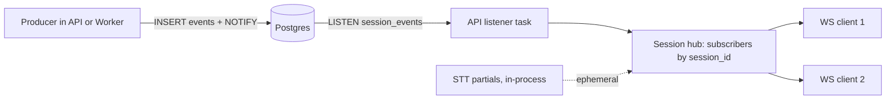

# 11 — API, Database & Realtime Events (reference for all phases)

## Purpose
The single reference for REST endpoints, WebSocket protocols, event payloads and the PostgreSQL schema. Other docs link here.

## Conventions
- Base `/api/v1`. JSON. UUIDv7 ids [R] (time-ordered).
- Errors use `application/problem+json` (doc 01).
- Auth: `Authorization: Bearer <access JWT>`. WS uses `?ticket=` from `POST /auth/ws-ticket`.
- Pagination: `?cursor=&limit=` (max 200).
- Times: server UTC ISO-8601. Media offsets: integer ms from session start.
- Idempotency: `Idempotency-Key` header on uploads.

## REST endpoints
| Method | Path | Purpose | Phase |
|---|---|---|---|
| POST | /auth/register, /auth/login, /auth/refresh, /auth/logout | Auth | P0 |
| POST | /auth/ws-ticket `{session_id, purpose: audio|events}` | WS ticket | P0 |
| POST | /sessions | Create session | P0 |
| GET | /sessions, /sessions/{id} | List / detail | P0 |
| GET | /sessions/{id}/state | Full snapshot for UI resync | P4 |
| PATCH | /sessions/{id} | Update (status, lender) | P0 |
| PUT | /sessions/{id}/facts | Rules facts | P7 |
| DELETE | /sessions/{id} | Erase all data (async job) | P0/P8 |
| POST/DELETE | /sessions/{id}/consents[/{party}] | Consent record / revoke | P0 |
| POST | /sessions/{id}/recordings | Upload audio (multipart) | P1 |
| GET | /sessions/{id}/audio?channel=&from=&to= | Snippet (presigned redirect) | P1 |
| GET | /sessions/{id}/transcript?since_ms= | Segments | P1 |
| PATCH | /segments/{id}/speaker `{speaker_role}` | User correction | P1 |
| GET | /sessions/{id}/claims | Claims | P1 |
| PATCH | /claims/{id} | Dismiss / note / speaker | P1 |
| POST | /sessions/{id}/documents | Upload doc/photos | P2 |
| GET | /documents/{id}, /documents/{id}/pages/{n}/image, /documents/{id}/clauses | Doc data | P2 |
| POST | /documents/{id}/pages/{n}/retake | Replace page | P2 |
| GET | /sessions/{id}/results, /results/{id}/history | Results | P2 |
| POST | /sessions/{id}/reverify | Manual re-run | P2 |
| GET | /calculations/{id} | Calc trace | P3 |
| POST | /sessions/{id}/qa ; GET /sessions/{id}/qa | Ask your contract | P6 |
| GET | /lenders/search?q= ; GET /rules | Public data / rules | P7 |
| POST | /sessions/{id}/report → GET /reports/{id} | Report export | P8 |
| GET | /healthz, /readyz | Health | P0 |

## WebSockets
**Audio:** `/ws/sessions/{id}/audio?channel=mic|tab&ticket=` (protocol in doc 02).

**Events:** `/ws/sessions/{id}/events?ticket=&since=<seq>`. Server → client envelope:
```json
{"type":"verification.updated","session_id":"…","seq":1842,"ts":"2026-…Z","payload":{…}}
```
| type | payload | producer |
|---|---|---|
| `session.status` | `{state, recording, channels:{mic,tab}, stt, reason?}` | sessions/audio |
| `transcript.partial` | `{channel, text, start_ms}` (not persisted in `events`; ephemeral fan-out) | stt |
| `transcript.committed` | `Segment` | transcript |
| `speaker.updated` | `{segment_ids[], speaker_role, speaker_source}` | transcript |
| `claim.created` / `claim.updated` | `Claim` | claims |
| `document.status` | `{document_id, stage, progress, warnings[]}` | documents |
| `verification.updated` | `VerificationResult` (+`partial: bool`) | orchestrator |
| `qa.answer` | `{qa_id, status, answer?, citations?}` | rag |
| `error` | `{code, message, retryable}` | any |

Client → server on the events WS: only `{"type":"ping"}`. The server answers `pong`. The server sends a heartbeat every 20 s.



STT partials stay in-process because the audio WS and the events WS for a session terminate on the same API instance. For multi-instance deployments, use sticky sessions by `session_id` (ADR-002 note).

## Database schema (PostgreSQL 16)
```sql
CREATE EXTENSION IF NOT EXISTS vector; CREATE EXTENSION IF NOT EXISTS pgcrypto; CREATE EXTENSION IF NOT EXISTS pg_trgm;

CREATE TABLE users (id uuid PRIMARY KEY, email citext UNIQUE NOT NULL, password_hash text NOT NULL,
  locale text DEFAULT 'en', created_at timestamptz DEFAULT now(), deleted_at timestamptz);

CREATE TABLE sessions (id uuid PRIMARY KEY, owner_id uuid REFERENCES users NOT NULL,
  mode text CHECK (mode IN ('in_person','meet_tab','upload')), state text NOT NULL,
  product_type text, language_hint text, lender_entity_id uuid, lender_name_raw text,
  facts jsonb DEFAULT '{}', started_at timestamptz, ended_at timestamptz,
  retention_until timestamptz NOT NULL, created_at timestamptz DEFAULT now());

CREATE TABLE consents (id uuid PRIMARY KEY, session_id uuid REFERENCES sessions ON DELETE CASCADE,
  party text CHECK (party IN ('customer','agent')), method text, consent_text_version text, locale text,
  audio_ref jsonb, granted_at timestamptz NOT NULL, revoked_at timestamptz, actor_id uuid);

CREATE TABLE audio_streams (id uuid PRIMARY KEY, session_id uuid REFERENCES sessions ON DELETE CASCADE,
  channel text, source text, sample_rate int, started_at timestamptz, ended_at timestamptz,
  final_object_key text, duration_ms int, vad_offset_map jsonb);
CREATE TABLE audio_chunks_index (stream_id uuid REFERENCES audio_streams ON DELETE CASCADE,
  seq int, start_ms int, end_ms int, object_key text, PRIMARY KEY (stream_id, seq));

CREATE TABLE transcript_segments (id uuid PRIMARY KEY, session_id uuid REFERENCES sessions ON DELETE CASCADE,
  channel text, revision int DEFAULT 1, is_current bool DEFAULT true,
  speaker_role text, speaker_source text, speaker_confidence real,
  text text NOT NULL, start_ms int, end_ms int, language text,
  avg_conf real, min_numeric_conf real, provider text, provider_segment_id text, created_at timestamptz DEFAULT now());
CREATE INDEX ON transcript_segments (session_id, start_ms) WHERE is_current;
CREATE TABLE transcript_words (segment_id uuid REFERENCES transcript_segments ON DELETE CASCADE,
  idx int, text text, start_ms int, end_ms int, confidence real, speaker_label text, PRIMARY KEY (segment_id, idx));

CREATE TABLE claims (id uuid PRIMARY KEY, session_id uuid REFERENCES sessions ON DELETE CASCADE,
  claim_type text, utterance_kind text, speaker_role text, speaker_source text,
  normalized_statement text, quote text NOT NULL, source_segment_ids uuid[], quote_span int4range,
  start_ms int, end_ms int, conditions jsonb, vagueness text, extraction_confidence real,
  asr_confidence real, min_numeric_conf real, readiness text, missing_inputs text[],
  verifiable bool, supersedes_claim_id uuid, dismissed bool DEFAULT false,
  prompt_version text, created_at timestamptz DEFAULT now(), updated_at timestamptz);
CREATE TABLE claim_values (id uuid PRIMARY KEY, claim_id uuid REFERENCES claims ON DELETE CASCADE,
  field text, raw_text text, quantity text, value numeric, value_low numeric, value_high numeric,
  comparator text, period text, rate_basis text, of_what text, includes_gst bool);

CREATE TABLE documents (id uuid PRIMARY KEY, session_id uuid REFERENCES sessions ON DELETE CASCADE,
  kind text, source text CHECK (source IN ('pdf','camera','image_upload')), status text,
  page_count int, sha256 text, object_key text, docling_key text, warnings jsonb, created_at timestamptz DEFAULT now());
CREATE TABLE document_pages (document_id uuid REFERENCES documents ON DELETE CASCADE, page int,
  printed_page text, image_key text, width real, height real, text_source text, ocr_confidence real,
  quality jsonb, PRIMARY KEY (document_id, page));
CREATE TABLE clauses (id uuid PRIMARY KEY, document_id uuid REFERENCES documents ON DELETE CASCADE,
  page_start int, page_end int, bboxes jsonb, section_path text, label text, text text NOT NULL,
  is_table_row bool, text_source text, ocr_confidence real, min_numeric_conf real, ord int);
CREATE TABLE doc_terms (id uuid PRIMARY KEY, document_id uuid REFERENCES documents ON DELETE CASCADE,
  clause_id uuid REFERENCES clauses, field text, value_raw text, value numeric, unit text,
  basis text, conditions jsonb, includes_gst bool);
CREATE TABLE chunks (id uuid PRIMARY KEY, document_id uuid REFERENCES documents ON DELETE CASCADE,
  clause_id uuid REFERENCES clauses, page int, section_path text, text text,
  tsv tsvector GENERATED ALWAYS AS (to_tsvector('simple', coalesce(section_path,'')||' '||text)) STORED,
  embedding vector(1024), embedding_model text);   -- dim set by ADR-005
CREATE INDEX ON chunks USING gin (tsv);
CREATE INDEX ON chunks USING hnsw (embedding vector_cosine_ops);

CREATE TABLE verification_runs (id uuid PRIMARY KEY, session_id uuid REFERENCES sessions ON DELETE CASCADE,
  trigger text, thresholds_hash text, created_at timestamptz DEFAULT now());
CREATE TABLE verification_results (id uuid PRIMARY KEY, claim_id uuid REFERENCES claims ON DELETE CASCADE,
  run_id uuid REFERENCES verification_runs, version int, is_current bool, status text, reason_code text,
  headline text, reason text, severity text, engine_verdicts jsonb, suggested_question text,
  created_at timestamptz DEFAULT now(), UNIQUE (claim_id, version));
CREATE TABLE evidence_links (id uuid PRIMARY KEY, result_id uuid REFERENCES verification_results ON DELETE CASCADE,
  kind text, segment_ids uuid[], start_ms int, end_ms int, quote text,
  document_id uuid, page int, clause_id uuid, clause_text text, bboxes jsonb, ocr_confidence real,
  calculation_id uuid, rule_id text, source_url text, payload jsonb);

CREATE TABLE calculations (id uuid PRIMARY KEY, session_id uuid REFERENCES sessions ON DELETE CASCADE,
  formula_id text, formula_version int, inputs jsonb, outputs jsonb, assumptions text[], missing text[],
  tolerance jsonb, created_at timestamptz DEFAULT now());

CREATE TABLE rules (id text PRIMARY KEY, version int, body jsonb, source_url text, effective_from date,
  effective_to date, reviewed_by text, enabled bool);
CREATE TABLE public_entities (id uuid PRIMARY KEY, name text, normalized_name text, aliases text[], category text,
  registration_no text, regulator text, source_url text, source_date date);
CREATE INDEX ON public_entities USING gin (normalized_name gin_trgm_ops);
CREATE TABLE public_snapshots (id uuid PRIMARY KEY, entity_id uuid REFERENCES public_entities, product_type text,
  field text, value_low numeric, value_high numeric, unit text, conditions text, source_url text, captured_at date, captured_by text);

CREATE TABLE qa_messages (id uuid PRIMARY KEY, session_id uuid REFERENCES sessions ON DELETE CASCADE,
  question text, answer jsonb, status text, created_at timestamptz DEFAULT now());

CREATE TABLE events (seq bigserial PRIMARY KEY, session_id uuid NOT NULL, type text, payload jsonb, ts timestamptz DEFAULT now());
CREATE INDEX ON events (session_id, seq);
CREATE TABLE jobs (id uuid PRIMARY KEY, kind text, payload jsonb, status text, attempts int DEFAULT 0,
  run_after timestamptz DEFAULT now(), locked_by text, locked_at timestamptz, last_error text, created_at timestamptz DEFAULT now());
CREATE INDEX ON jobs (status, run_after);
CREATE TABLE audit_log (id bigserial PRIMARY KEY, actor_id uuid, action text, target_type text, target_id uuid,
  meta jsonb, ip inet, ts timestamptz DEFAULT now());   -- append-only: REVOKE UPDATE, DELETE
```

**Ownership enforcement:** every repository method takes `owner_id`. Optionally enable Postgres RLS with `SET app.user_id` per request [R, P8].

## Storage layout
- `audio/{session}/{channel}/{seq}.pcm`, `audio/{session}/{channel}.flac`
- `documents/{doc}/original.*`, `/pages/{n}.webp`, `/docling.json`
- `exports/{session}/{report_id}.pdf`

Server-side encryption is on. Presigned GET with 5 min TTL.

## Testing
- An OpenAPI schema snapshot test.
- Contract tests for each event type (JSON Schema generated from Pydantic, shared with the frontend via `openapi-typescript`).
- A migration up/down test.

## Acceptance criteria
- Every endpoint has a request/response schema in OpenAPI.
- The frontend types are generated, with no hand-written duplicates.
- Deleting a session removes all rows (CASCADE) and object-storage prefixes; verified by test.
