# 13 — Implementation Roadmap & Human Review

The goal is a **working end-to-end MVP first**: upload audio + PDF → evidence-linked results. Live streaming comes after that. The four P0 innovations are tracked explicitly in every phase.

## P0 innovation tracker
| Innovation | Minimum viable implementation (MVI) | Phase | Later enhancement | Phase |
|---|---|---|---|---|
| **P0-1 Live Promise Verification** | Realtime STT on committed segments → debounced incremental extraction → readiness tags → engines → WS results. Auto re-verify on document arrival | P4 | Speculative extraction on partials (display only); severity priority queue; cancel stale runs | P9 |
| **P0-2 Evidence-Linked Contradictions** | CONFLICT schema validator + DB integrity validator. Spoken quote/timestamp + page/clause/bbox. Evidence drawer with audio + page highlight | P1 (spoken) → **P2 (complete)** | Report export with embedded evidence | P8 |
| **P0-3 Hybrid Financial Reasoning** | Decimal formulas, APR via IRR, calc traces, missing inputs/assumptions | **P3** | More products (gold, MSME balloon/step-up EMI) | P9 |
| **P0-4 Uncertainty-Aware Verification** | 4 statuses + reason codes from P1. ASR gate (P1), OCR gate (P2), speaker gate (P4) | P1–P4 | **Calibrated thresholds** from the eval set; noise-robustness tests | **P5** |

## Pre-work: experiments (run in parallel with P0)
E1–E9 as defined in the master report §21. E2, E3 and E5 must report before HC-3 and HC-4.

---

## Phases

### P0 — Foundation
- **Objective:** a runnable skeleton (doc 01).
- **Features:** compose, DB, auth, sessions, consent, events bus, jobs, provider protocols, CI, frontend shell.
- **Dependencies:** HC-1.
- **Files:** `backend/app/core/*`, `modules/{auth,sessions,consent,audit,realtime}`, `worker/*`, `alembic/0001`, `infra/docker-compose.yml`, `frontend/src/app`, `lib/`.
- **Expected output:** login → create session → consent → events WS receives a test event.
- **Acceptance:** doc 01 criteria.
- **Risks:** low.
- **Human review:** none beyond HC-1.

### P1 — Upload → Transcript → Claims
- **Objective:** a recorded conversation produces diarized transcript and structured claims.
- **Features:** recording upload (doc 02), ElevenLabs batch adapter with diarization (doc 03), role assignment + swap, claim extraction + normalisers (doc 04), claims UI list, `NOT_VERIFIED(no_document)` results with spoken evidence.
- **Dependencies:** P0, HC-2, E2/E3 results.
- **Files:** `modules/{audio,stt,transcript,claims}`, `llm/<adapter>`, `prompts/claim_extract_v1.md`, `eval/datasets/conversations`, `frontend/features/{results (basic)}`.
- **Acceptance:** doc 04 extraction targets on the eval set. 100% verbatim quotes.
- **Risks:** Hinglish quality (E2); LLM provider undecided (ADR-004 must be settled here).
- **Human review:** **HC-3** (STT report).

### P2 — Documents + Contract engine (P0-2 complete)
- **Objective:** PDF or photos produce clauses with provenance, and claims are verified against them with evidence.
- **Features:** upload + camera capture, pre-processing, Docling/OCR, confidence pass, clause segmenter, doc_terms, chunks + hybrid retrieval, contract engine, orchestrator v1 (merge + validators), evidence drawer with page highlight.
- **Dependencies:** P0, P1 (claims), E5, ADR-005.
- **Files:** `modules/documents/*`, `modules/rag/retrieval.py`, `engines/contract/*`, `modules/orchestrator/*`, `frontend/features/{documents,results}`.
- **Acceptance:** doc 05 + doc 08 criteria. A demo-able "Agent said 0% fee → Page 3 says 2%" from an uploaded recording + photo.
- **Risks:** OCR on photos; NLI quality (E6).
- **Human review:** **HC-4**.

### P3 — Finance engine (P0-3 complete) + core rules subset
- **Objective:** deterministic checks of EMI, APR, fees and net disbursement. KFS/APR + prepayment rules in shadow/demo mode.
- **Files:** `engines/finance/*`, `golden/*.yaml`, `engines/rules/{engine.py, loader.py}`, `data/rules/{kfs,prepay}.yaml`, frontend `CalcTrace`.
- **Dependencies:** P1 (values), P2 (doc terms), E7.
- **Acceptance:** doc 06 criteria (100% golden).
- **Human review:** **HC-5**.

### P4 — Live streaming + orchestrator (P0-1 complete)
- **Objective:** the full live demo: in-person mic and Meet tab + mic, with real-time claims and verdicts.
- **Features:** AudioWorklet capture + audio WS (doc 02), Silero VAD gate, ElevenLabs realtime adapter, speaker resolver (channel / inferred + periodic batch diarization), incremental extraction, live re-verification, live screen UI, capture health, reconnect/resume.
- **Dependencies:** P1–P3, E1, E4.
- **Acceptance:** latency targets (claim p50 ≤6 s, verdict ≤10 s). 30-min stability. An inferred-speaker CONFLICT is never emitted.
- **Risks:** realtime latency from India; no realtime diarization; mobile background audio.
- **Human review:** a live demo dry run with the team.

### P5 — Uncertainty calibration (P0-4 complete)
- **Objective:** thresholds tuned on data; every UNCLEAR/NOT_VERIFIED explained.
- **Features:** eval harness sweeps, noise/OCR perturbation suite, `thresholds.yaml` versioning, UI "why unclear" explanations and suggested questions.
- **Acceptance:** CONFLICT precision ≥0.90. 0% injected low-confidence → CONFLICT.
- **Human review:** calibration report sign-off.

### P6 — Ask Your Contract
- **Objective:** grounded Q&A with validated citations (doc 09).
- **Acceptance:** doc 09 criteria.
- **Human review:** a graded answer sample.

### P7 — Rules + Public data engines
- **Objective:** the full MVP rule corpus (shadow until reviewed), RBI entity lookup, 5 lender snapshots, session facts UI.
- **Acceptance:** doc 07 criteria.
- **Human review:** **HC-6** (legal/compliance).

### P8 — Hardening + demo
- **Objective:** safe enough for a supervised pilot, and a polished demo.
- **Features:** security controls (doc 12), deletion/retention jobs, report export, load test, accessibility pass, Hindi copy review, demo pack (script, printed form, backup recording, offline fallback video).
- **Acceptance:** doc 12 criteria. Demo runs 3 times in a row without intervention.
- **Human review:** **HC-7** (legal, before any real users) and **HC-8** (demo readiness).

### P9 — Phase 2 (post-MVP)
- Insurance: activate the reserved claim types, policy-wording ingestion, IRDAI rules corpus (needs its own research).
- Meet Media API spike (E8).
- Speculative partial extraction.
- A second STT provider.
- Lender/compliance-side use cases [Q-7].

```mermaid
gantt
  dateFormat  X
  axisFormat  %s
  section Foundation
  P0 Foundation           :p0, 0, 2
  Experiments E1-E9       :ex, 0, 3
  section MVP pipeline
  P1 Upload→Claims        :p1, after p0, 2
  P2 Docs+Contract        :p2, after p0, 3
  P3 Finance              :p3, after p1, 2
  P4 Live                 :p4, after p3, 3
  P5 Calibration          :p5, after p4, 1
  P6 RAG                  :p6, after p2, 2
  P7 Rules+Public         :p7, after p3, 2
  P8 Hardening+Demo       :p8, after p5, 2
```

*(Units are relative "sprints", not calendar dates. Fix the real dates once team size and deadline are known [Q-12].)*

### Fast demo path (if a hackathon deadline applies)
P0 (minimal) → P2 contract engine on **camera photo** + P4 **in-person live mic** + P3 fee/EMI checks only. Skip P6/P7, keep the status taxonomy and evidence validator intact. This covers the Problem Statement demo exactly: pushy agent + printed form + on-screen mismatch.

---

## Human review checkpoints
| ID | Trigger | Inputs to review | Decision |
|---|---|---|---|
| HC-1 | Now | Master report, doc 14 ADRs | Architecture, scope, taxonomy, structure |
| HC-2 | Before P1 code | Doc 04 schema/few-shots, doc 08 statuses/wording | Claim schema & evidence policy |
| HC-3 | After E1–E3 | STT experiment report, pricing | ElevenLabs config; fallback provider need |
| HC-4 | After E5 | OCR report on photos | OCR backend; thresholds; capture guidance |
| HC-5 | In P3 | Golden finance table, APR method | Formulas & tolerances |
| HC-6 | In P7 | Rule corpus | Legal/compliance sign-off per rule |
| HC-7 | Before real users | Consent UX, privacy notice, legal memo | Go/no-go for pilot |
| HC-8 | End P8 | Eval reports, demo run | Demo/pilot readiness |

At each checkpoint the coding agent must present:
1. progress so far
2. what was inspected or measured
3. the options considered
4. a recommendation with reasoning
5. the exact files or decisions to approve

It then **waits for approval**.
