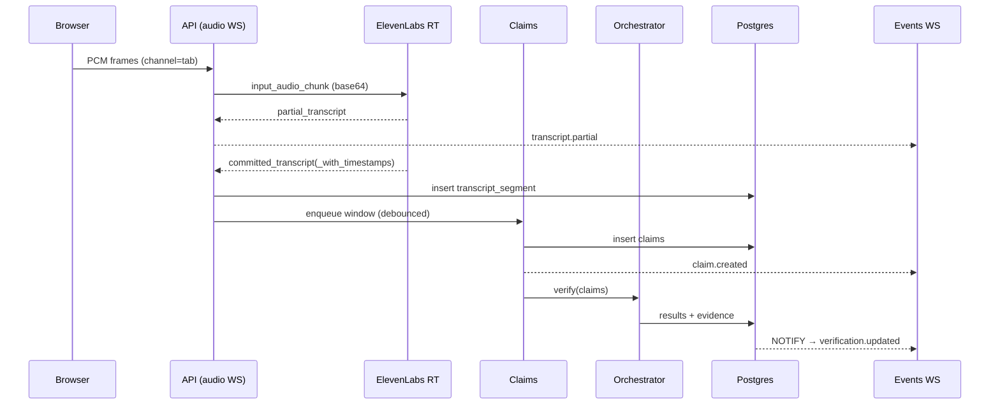
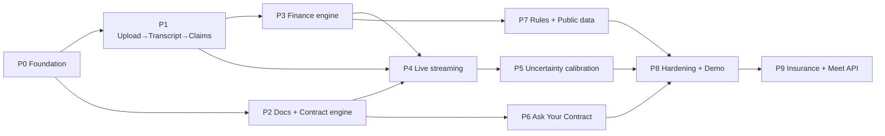

# SaidSigned — Master Architecture Report

**Version:** 0.1 (planning blueprint, nothing implemented)
**Date:** 2026-11-13
**Status:** Draft for human review (see §20 *Human approval checkpoints*)

**Labelling convention used in all SaidSigned docs**

| Label | Meaning |
|---|---|
| **[V]** Verified | Checked against a source on the retrieval date given. URL listed in §22. |
| **[A]** Assumption | Believed true but not yet checked. Needs an experiment or a doc check. |
| **[R]** Recommendation | Our design choice. Can be changed at a review checkpoint. |
| **[Q]** Open question | Needs a decision or more information. |

---

## 1. Executive summary

SaidSigned checks what a loan agent **said** against what the customer is about to **sign**. With explicit consent it does five things:

1. It captures the agent's pitch from one of three sources: an in-person microphone, a Google Meet tab, or an uploaded recording.
2. It transcribes the pitch with ElevenLabs Scribe.
3. It extracts structured claims such as "processing fee is zero" or "interest is 11% reducing".
4. It reads the loan agreement or KFS through Docling and OCR, including a phone photo of a printed form.
5. It checks every claim with four independent engines (contract, financial maths, RBI rules, public lender data) and pushes **evidence-linked** results to a React PWA while the conversation is still going.

Every result gets one of four statuses: **Conflict / Match / Unclear / Not verified**. A `Conflict` cannot exist without four pieces of evidence: the spoken quote, its timestamp, the contract clause, and the page number. Calculations (EMI, APR, fees + GST, net disbursement) are done in deterministic Python. The LLM only extracts values and judges semantic meaning. Low speech-recognition or OCR confidence downgrades a would-be `Conflict` to `Unclear`, so the product never accuses an agent on shaky evidence.

**Recommended architecture [R]:** a modular monolith.
- Backend: FastAPI with REST and WebSockets, plus one worker process for heavy jobs.
- Database: PostgreSQL 16 with pgvector and full-text search. The same database serves as the job queue, the hybrid retrieval store, and the event bus via LISTEN/NOTIFY.
- Storage: S3-compatible object storage, MinIO locally.
- Frontend: React + Vite + Tailwind PWA.
- LLM and embeddings: behind provider-agnostic interfaces. The model choice is an open ADR.

**Scope decision (approved 2026-11-13):** the MVP covers **loans**. The claim schema and engines are designed so that **insurance** (coverage, exclusions, waiting periods, bundled insurance on loans) can be added in phase 2 without changing the schema.

**Top unresolved risks:**
1. ElevenLabs realtime has **no speaker diarization** [V, secondary source]. For a single-mic in-person meeting, who-said-what must be inferred and later corrected by a batch re-pass.
2. Hinglish transcription accuracy has not been measured.
3. Per-token OCR confidence from Docling is unconfirmed.
4. The APR annualisation method must be matched to the RBI KFS illustration.
5. Recording-consent law needs professional legal review.

---

## 2. Problem Statement analysis

**Source:** the original problem statement, idea #1, "'Said vs. signed' checker for loan and insurance mis-selling (SDG 8/10)". Read in full.

| Aspect | Extracted from the Problem Statement |
|---|---|
| Problem | Agents make verbal promises ("no processing fee", "this covers everything") that the paperwork contradicts. Customers sign without reading and have no proof of what was said. |
| Target users | Borrowers and policyholders (primary). Secondary: family members helping them, consumer advocates, NGOs, and potentially compliance teams at lenders. |
| Stakeholders | Customers, agents/DSAs, lenders/insurers, regulators (RBI, IRDAI), grievance bodies. |
| Product types | **Loans and insurance.** |
| Core function | With consent: transcribe the pitch → extract claims (fees, interest rate, coverage, exclusions) → OCR the actual document → flag mismatches **in real time**. |
| Example output | "Agent said zero fees. Page 3 lists a 2% fee." This implies a quote, a page reference and a concrete reason. |
| Hard parts (explicit) | (1) Turning loose speech into structured terms. (2) Matching them against clauses in a **messy scan**. (3) **Avoiding false accusations** when the agent was only imprecise. |
| Demo (explicit) | A teammate plays a pushy agent, someone **holds up a printed loan form**, and the mismatch appears on screen. This implies **camera capture of paper** plus **live audio**. |
| Non-functional | Consent, real-time latency, robustness to messy scans, fairness to agents (low false-positive rate), and use by non-expert customers. |
| SDG framing | SDG 8 (decent work and economic growth, financial inclusion) and SDG 10 (reduced inequalities: protecting less-literate and less-powerful customers). |
| Success metrics (implied, not stated) | Correct mismatch detection, low false accusations, time from statement to flag, and usability. **No numeric targets are given.** We propose some in §17. |

### 2.1 Conflicts between sources (flagged, not silently resolved)

| # | Conflict | Sources | Resolution |
|---|---|---|---|
| C1 | Problem Statement covers **loans and insurance**. The blueprint brief says "loan mis-selling detection". | PS vs brief §2 | **Approved:** loans in the MVP, schema insurance-ready, insurance in phase 2 (roadmap P9). |
| C2 | PS says "flags mismatches". The brief requires 4 statuses. | PS vs brief §3 | Use the 4-status taxonomy. "Mismatch"/"flag" in UI copy maps to `Conflict` (§6.4). |
| C3 | PS demo says "hold up a printed loan form" (camera). The brief only says "upload the loan agreement". | PS vs brief §2 | Add **camera capture** (photo or multi-page photo) as a P0 document input. This is a gap in the brief. |
| C4 | Brief §4 asks for a Google Meet bot. Research shows the official Meet Media API is Developer Preview and needs every participant enrolled. | brief vs research | **Approved:** tab-capture in the MVP. The bot is a research spike only. |
| C5 | The brief puts real-time speaker identification in the pipeline. ElevenLabs realtime has no diarization. | brief §5 vs research | Speaker comes from the **channel** where possible (mic = customer, tab = remote/agent). In single-mic mode it is **inferred** and marked as such, then corrected by a batch diarization re-pass. |
| C6 | No PPT, UI designs or prior documents exist in the repo, although the brief mentions them. | brief §1 | The repo audit records them as absent. If they exist elsewhere, review at **HC-1**. |

---

## 3. Requirement traceability matrix

| # | Problem Statement requirement | Current project coverage | Planned implementation | Gap / Risk |
|---|---|---|---|---|
| R1 | Consent before capturing the pitch | None (empty repo) | Consent module: consent record per session and per party, a recording indicator, consent re-check before every stream (doc 12 §Security, doc 11 `consents`) | Two-party consent law needs legal review (**HC-7**) |
| R2 | Transcribe the agent's verbal pitch | None | `STTProvider` interface. ElevenLabs `scribe_v2_realtime` for live audio, Scribe v2 batch for uploads (doc 03) | Hinglish WER unknown (experiment E2) |
| R3 | Identify the **agent's** claims (not the customer's) | None | Channel-based speaker roles. LLM role inference in single-mic mode. Batch diarization correction (doc 03, doc 04) | No realtime diarization (C5) |
| R4 | Extract claims: fees, interest rate, coverage, exclusions | None | Claim extraction with Pydantic `Claim` schema and typed `ExtractedValue`s. Insurance claim types reserved (doc 04) | Insurance types not active in the MVP (C1) |
| R5 | Read the actual document through OCR, including messy scans and photos | None | Docling with an OCR backend. Camera multi-page capture, deskew and contrast pre-processing. Page/bbox provenance (doc 05) | OCR confidence availability (E5) |
| R6 | Flag mismatches **in real time** | None | P0-1 Live Promise Verification: incremental extraction on committed segments, orchestrator, WS `verification.updated` (doc 08) | End-to-end latency target: 6 s p50 (E1) |
| R7 | Output like "Agent said X. Page N says Y." | None | P0-2 evidence-linked results with quote, timestamp, clause, page, reason. Enforced by a schema validator (doc 08) | — |
| R8 | Avoid false accusations when the agent was imprecise | None | P0-4 uncertainty-aware statuses, confidence gates, vagueness detection, neutral wording ("ask the agent") (doc 08) | Needs calibration data (P5) |
| R9 | Structured terms from loose speech ("2 percent", "do taka", "zero fees") | None | LLM extraction plus deterministic normalisers for numbers, Hindi numerals, lakh/crore, and % vs flat (doc 04, doc 06) | Hinglish number words (E2) |
| R10 | Demo: pushy agent + printed form + on-screen mismatch | None | Live mic mode, camera capture, results screen. Scripted demo pack (doc 13 P8) | — |
| R11 | Works for policyholders (insurance) | None | Phase-2 roadmap P9. Schema reserved now | Deferred by approved decision |
| R12 | SDG 8/10 inclusion: usable by less-literate users | None | Plain-language result cards, Hindi/English UI strings, a "questions to ask" list, large type (doc 10) | Localisation scope [Q-9] |
| B1 (brief) | Hybrid financial reasoning | None | P0-3 finance engine with Decimal maths and stored calculation traces (doc 06) | APR method (E7) |
| B2 (brief) | Rules engine (RBI) | None | Curated, versioned rule corpus with source URLs and effective dates (doc 07) | Legal review (**HC-6**) |
| B3 (brief) | Public data engine | None | RBI regulated-entity lookup and lender published-terms snapshots (doc 07) | Source formats [A] |
| B4 (brief) | Ask Your Contract (RAG) | None | Hybrid BM25 + vector retrieval, rerank, citation validation (doc 09) | — |
| B5 (brief) | Meet bot / tab capture / upload | None | Tab capture + mic (MVP), upload (MVP), Meet Media API (spike) (doc 02) | Chromium-only tab audio [V] |

---

## 4. Existing repository audit

Inspected on 2026-11-13:

- `/Users/krish/SaidVsSigned/` contains **no files**. It is not a git repository.
- There is no README, no PPT, no UI design and no architecture notes.
- No saved project memory exists.

**Conclusion:** this is a greenfield project. Nothing has to stay compatible. Every module in this blueprint is new. The only project inputs are the Problem Statement and the blueprint brief.

**Action [Q-1]:** if the SaidSigned PPT or UI designs exist elsewhere, add them to `docs/reference/`. Re-check this report for conflicts at **HC-1**.

---

## 5. Product understanding

**User journey (MVP):**

1. **Start session.** The customer opens the PWA, names the lender (optional), chooses an input mode (*In-person mic* / *Google Meet tab* / *Upload recording*) and gives consent. The agent is told about the recording; for in-person mode, a "consent read-out" screen is shown to the agent.
2. **Listen.** Live transcript appears with speaker labels (`Customer`, `Agent`, `Agent (inferred)`). Claims pop up as cards as soon as they are detected.
3. **Check what we can now.** The finance engine checks internal consistency immediately. Example: "₹5 lakh at 10.5% for 5 years = ₹9,800 EMI" is checked against the EMI formula, which gives ₹10,747. The rules engine checks things like "no prepayment charge on floating-rate personal loan". The public data engine checks things like "lender is RBI-registered".
4. **Add the paper.** The customer photographs the printed form or KFS (camera, multi-page) or uploads a PDF. The contract engine then verifies every pending claim and re-checks earlier ones.
5. **Review.** The results board groups items as Conflict → Unclear → Not verified → Match. Each card opens an evidence drawer with the audio snippet, quote, timestamp, page image with highlighted clause, calculation trace and reason.
6. **Ask.** The customer can type questions in "Ask your contract", and the app generates a **"Questions to ask before signing"** list.
7. **Export.** A session report (PDF/JSON) lists claims and evidence. This is the "proof of what was said".

**What SaidSigned is not:** it is not a fraud detector, not legal advice, and not a lender rating. The UI copy always says "possible mismatch — ask the agent to clarify". It never says "the agent lied".

---

## 6. The four P0 innovations

All four are **P0 — Must Build**. They are traced into the architecture (§7), the roadmap (§19) and doc 13.

### 6.1 P0-1 Live Promise Verification

- **Minimum viable (roadmap P4):**
  - ElevenLabs realtime produces committed segments.
  - A sliding window of the last N committed segments plus a claims-so-far summary goes to the claim extractor (debounced at 1.5 s).
  - Each new claim is tagged `checkable_now | needs_document | needs_info` and dispatched to the engines.
  - Results stream over WS.
  - When a document arrives later, every `needs_document` claim is re-run automatically.
- **Later enhancement:** speculative extraction on partial transcripts (show as "listening…" and never verify on partials), plus per-claim incremental re-verification when a later utterance qualifies an earlier one ("…but only if you take the insurance").
- **Target [R]:** p50 ≤ 6 s from the end of a sentence to its claim card, and p50 ≤ 10 s to a finance/rules verdict. Validated by experiment E1.

### 6.2 P0-2 Evidence-Linked Contradiction Detection

- `VerificationResult` has `evidence: list[EvidenceLink]`.
- A Pydantic validator **rejects** any `CONFLICT` that lacks:
  - (a) a `SpokenEvidence` with quote, segment id, start/end ms and speaker; **and**
  - (b) either a `DocumentEvidence` with document id, page number, clause id, verbatim clause text and bbox, **or** a `CalculationEvidence` / `RuleEvidence` with a trace id and source URL; **and**
  - (c) a non-empty `reason`.
- Quotes are copied from stored transcript text by id, never re-generated by an LLM. Clause text is copied from stored document text by id.
- If no clause is found, the result is `NOT_VERIFIED` with reason `clause_not_found`. The app never invents a reference.

### 6.3 P0-3 Hybrid Financial Reasoning

- The LLM extracts `{quantity, value, unit, basis, period, conditionality}`.
- Python `Decimal` code computes EMI (reducing and flat), total interest, total repayment, fees + GST, net disbursement, APR (IRR of net cash flows), prepayment and penal-charge amounts.
- Missing inputs are reported in `missing_inputs[]`. Assumptions are explicit (e.g. "assumed monthly compounding; agent did not say") and lower the status to `UNCLEAR` when they affect the verdict.
- Every computation is stored in `calculations` (inputs, formula id, formula version, outputs, tolerance).

### 6.4 P0-4 Uncertainty-Aware Verification

**Taxonomy (single source of truth):**

| Status (enum) | UI label | Meaning | Problem Statement wording |
|---|---|---|---|
| `CONFLICT` | Conflict | Reliable evidence contradicts the claim | "mismatch", "flag" |
| `MATCH` | Match | Reliable evidence supports the claim | — |
| `UNCLEAR` | Unclear | Evidence exists, but confidence, vagueness or ambiguity prevents a firm verdict | "agent was simply imprecise" |
| `NOT_VERIFIED` | Not verified | No usable evidence yet (no document, clause not found, missing inputs, engine not applicable) | — |

**Decision gates:**
- ASR confidence of the quoted span, especially numeric tokens, below `T_asr` → the result is at most `UNCLEAR`.
- OCR confidence of the clause or numeric token below `T_ocr` → the result is at most `UNCLEAR`.
- Claim vagueness ("very low fees") → `UNCLEAR`, with a suggested question.
- Retrieval score below `T_ret` → `NOT_VERIFIED`.
- Semantic verdicts require NLI/LLM agreement.

Every `UNCLEAR` or `NOT_VERIFIED` carries a machine-readable `reason_code` and human text. Thresholds start as configuration values and are calibrated in roadmap P5.

---

## 7. Proposed architecture

### 7.1 System diagram

```mermaid
flowchart LR
  subgraph Client["React PWA (Vite + Tailwind)"]
    MIC[Mic capture<br/>getUserMedia]
    TAB[Meet tab capture<br/>getDisplayMedia]
    CAM[Camera / file upload]
    UI[Live transcript · Claim cards · Evidence drawer · Ask-your-contract]
    AW[AudioWorklet<br/>16 kHz s16le mono]
    MIC-->AW
    TAB-->AW
  end

  subgraph API["FastAPI app (modular monolith)"]
    WSA[/WS /ws/sessions/{id}/audio/]
    WSE[/WS /ws/sessions/{id}/events/]
    REST[/REST /api/v1/.../]
    AUD[audio module<br/>VAD · buffering · storage]
    STT[stt module<br/>STTProvider]
    TR[transcript module]
    CL[claims module<br/>LLMProvider]
    ORC[orchestrator]
    ENG1[contract engine]
    ENG2[finance engine]
    ENG3[rules engine]
    ENG4[public data engine]
    RAG[rag module]
    CONS[consent · auth · audit]
  end

  subgraph Worker["Worker process"]
    DOC[document ingestion<br/>Docling + OCR]
    BSTT[batch STT + diarization]
    EMB[embeddings]
  end

  subgraph Infra
    PG[(PostgreSQL 16<br/>pgvector · FTS · jobs · LISTEN/NOTIFY)]
    S3[(Object storage<br/>MinIO / S3)]
  end

  EL[(ElevenLabs Scribe<br/>realtime WS + batch REST)]
  LLM[(LLM provider<br/>TBD - ADR-004)]

  AW-- PCM frames -->WSA
  CAM-- multipart -->REST
  WSA-->AUD-->STT<-->EL
  STT-->TR-->CL-->ORC
  CL<-->LLM
  ORC-->ENG1 & ENG2 & ENG3 & ENG4
  ENG1<-->RAG
  RAG<-->LLM
  REST-->DOC
  DOC-->PG
  DOC-->S3
  BSTT<-->EL
  AUD-->S3
  ORC-->PG
  PG-- NOTIFY -->WSE-->UI
```

### 7.2 Module boundaries [R]

| Module | Owns | Talks to |
|---|---|---|
| `auth` | users, JWT, WS tickets | all |
| `sessions` | session lifecycle, input mode, lender context | consent, audio |
| `consent` | consent records, revocation, recording state | sessions, audio |
| `audio` | WS ingest, framing, VAD, raw audio persistence | stt, storage |
| `stt` | `STTProvider` protocol, ElevenLabs adapters (realtime, batch) | audio, transcript |
| `transcript` | segments, speaker roles, confidence, corrections | claims |
| `claims` | extraction, normalisation, dedupe, readiness tagging | llm, orchestrator |
| `documents` | upload, camera images, Docling/OCR, pages, clauses, chunks | worker, rag |
| `engines/*` | four verifiers implementing `VerificationEngine` | orchestrator |
| `orchestrator` | routing, status aggregation, evidence validation, re-runs | engines, realtime |
| `rag` | hybrid retrieval, rerank, cited answers | documents, llm |
| `realtime` | event envelope, WS fan-out, LISTEN/NOTIFY bridge | all producers |
| `audit` | append-only audit log | all |
| `llm` | `LLMProvider` and `EmbeddingProvider` protocols | claims, engines, rag |

**Why a modular monolith [R]:** the team is small, deployment is a single region, and the bottlenecks are the external STT and LLM APIs rather than our CPU. Only the worker (Docling/OCR is CPU-heavy) runs as a separate process, from the same codebase. Redis is not needed: Postgres `SKIP LOCKED` provides the job queue and LISTEN/NOTIFY provides cross-process events (ADR-002).

### 7.3 Folder structure [R]

```
SaidVsSigned/
├── backend/
│   ├── pyproject.toml
│   ├── alembic/                     # migrations
│   ├── app/
│   │   ├── main.py                  # FastAPI factory, routers, lifespan
│   │   ├── core/                    # config, db, storage, logging, errors, security
│   │   ├── llm/                     # LLMProvider, EmbeddingProvider, adapters
│   │   ├── modules/
│   │   │   ├── auth/  sessions/  consent/  audit/  realtime/
│   │   │   ├── audio/  stt/  transcript/  claims/
│   │   │   ├── documents/  rag/  orchestrator/
│   │   │   └── engines/{base.py, contract/, finance/, rules/, public_data/}
│   │   └── worker/                  # job runner + job handlers
│   ├── data/
│   │   ├── rules/                   # versioned YAML rule corpus with source URLs
│   │   └── public/                  # curated lender snapshots
│   └── tests/{unit,integration,e2e,fixtures}
├── frontend/
│   ├── vite.config.ts  tailwind.config.ts
│   └── src/{app,features,components,audio,lib,i18n,pwa}
├── eval/                            # STT, claim, retrieval, contradiction eval harness + datasets
├── infra/docker-compose.yml         # postgres+pgvector, minio, api, worker, frontend
└── docs/
```

---

## 8. Audio input feasibility comparison

| Mode | MVP? | Feasibility | Both sides captured? | Speaker identity | Key limitation |
|---|---|---|---|---|---|
| **In-person mic (PWA)** | ✅ P0 | High: `getUserMedia` on all modern browsers | Yes, if both people are near the device | Inferred (single channel) → batch diarization correction | No realtime diarization; room noise |
| **Google Meet tab capture** | ✅ P0 | High on **Chromium desktop** [V]: tab audio via `getDisplayMedia({audio:true})` when the user shares a tab with "share tab audio" | Yes. Tab = remote participants, mic = customer | **Channel-based** (reliable) | Not available on Firefox, Safari or mobile [V]. The user must pick the tab manually |
| **Recorded upload** (WAV/MP3/M4A/WebM/OGG) | ✅ P0 | High | Depends on the recording | Batch diarization (Scribe v2) [V] | Not "live". Quality varies |
| **Google Meet Media API bot** | 🔬 Spike | Low for now: Developer Preview, and the **Cloud project, OAuth principal and all participants must be enrolled**. Restricted audio scope. 3 fixed virtual audio streams for the most relevant speakers [V] | Yes, if permitted | Per-stream CSRC mapping to participants | Not usable with real agents who are not enrolled. Preview terms restrict public apps |
| **Headless-browser Meet bot** (Puppeteer/Playwright joins as a guest) | ❌ Not planned | Technically possible as an experimental workaround | Mixed audio | Weak | Likely against Google ToS, brittle, needs host admission. **Not recommended** |
| **Cellular call** | ❌ | Normal browser mic cannot reliably capture the far end of a phone call; OS blocks call audio | — | — | Speakerphone + mic is a fallback with poor quality. Call merge/recording services are future research |

Details are in doc 02.

---

## 9. ElevenLabs integration research (retrieved 2026-11-13)

| Item | Finding | Label |
|---|---|---|
| Realtime endpoint | `wss://api.elevenlabs.io/v1/speech-to-text/realtime`, params as query string, model `scribe_v2_realtime` | [V] |
| Client→server messages | `input_audio_chunk` JSON messages carrying base64 audio | [V] (secondary) |
| Server events | `partial_transcript` (interim), `committed_transcript` (final for segment), `committed_transcript_with_timestamps` (word timing) | [V] official API reference + skills repo |
| Commit strategies | `manual` (default), `vad` (silence threshold, VAD threshold, min speech duration). The newer reference mentions `turn_prediction` | [V] (defaults differ across pages → verify in E1) |
| Audio encodings | PCM (several sample rates) and μ-law. Exact enum names (e.g. `pcm_16000`) **not confirmed** | [A] → E1 |
| Realtime diarization | **Not available.** Product FAQ reportedly says it is not a priority | [V] (secondary) |
| Batch diarization | Scribe v2 batch supports speaker diarization (32–48 speakers, sources differ) | [V] |
| Keyterms | Supported (≈50 for realtime) — use for lender names, "processing fee", "foreclosure", "KFS" | [V] (secondary) |
| Languages | 90+ languages. Hindi listed by third parties. Automatic language detection and code-switching claimed | [A] → E2 (Hinglish eval) |
| Word confidence | Unknown for realtime. Batch returns word-level detail including timestamps; a logprob field is believed to exist | [A] → E3 |
| Pricing | Realtime ≈ $0.39/audio-hour on the vendor page versus $0.28 in a third-party guide | [V] conflict → check the pricing page at **HC-3** |
| Client-side streaming | Supported via short-lived tokens | [V]. We still proxy through the backend [R] |

**Design consequences [R]:**
1. We proxy audio through our backend (not browser → ElevenLabs directly). This keeps the API key server-side and lets us persist audio for evidence playback.
2. We open **one realtime STT connection per channel** (mic and tab), which gives reliable speaker roles.
3. We use **VAD commit strategy** for realtime and add a server-side Silero VAD gate that skips sending long silences. This saves cost if billing is per audio second sent [A].
4. We run a **batch Scribe v2 diarization pass** on stored single-mic audio every 60 s and at session end. It re-labels speakers and triggers re-verification of affected claims.

---

## 10. Noise cancellation comparison

| Option | Where | Latency / CPU | Licence / cost | Fit for MVP | Label |
|---|---|---|---|---|---|
| **Browser WebRTC processing** (`noiseSuppression`, `echoCancellation`, `autoGainControl` constraints on `getUserMedia`) | Browser, mic only | Negligible | Free | ✅ **Default for live mic** | [V] standard constraints |
| **RNNoise** (WASM in AudioWorklet) | Browser or server | ~10 ms, 1 core | BSD-3 code. Weights' training-data licence questioned | ✅ Optional toggle if WebRTC NS is not enough | [V] |
| **DeepFilterNet 3** | Server (Python/Rust) | ~40 ms, modern CPU | Permissive code; weights licence unstated. Last release 2023 | 🟡 Offline enhancement for **uploaded recordings** only, behind a flag, if E9 shows WER gains | [V] / [A] |
| **Krisp SDK** | Browser/desktop SDK | Low | Commercial, pricing not public | ❌ Not for MVP | [A] |
| No processing | — | — | — | Baseline for E9 | — |

**Key point:** mic noise suppression (pre-capture) and enhancement of recorded or remote audio (post-capture) are separate problems. Meet already applies its own noise suppression to remote audio, so we **do not** denoise tab audio. Modern ASR is trained on noisy audio, and aggressive denoising can *increase* WER. No denoiser is enabled on uploads until experiment E9 shows a WER improvement on our test set.

---

## 11. Claim extraction design (summary — full spec in doc 04)

- **Input:** a window of committed transcript segments (ids, speaker role, text, timestamps, confidence) plus prior claims.
- **Output:** `ClaimExtractionResult` (Pydantic, strict JSON) with zero or more `Claim`s. Each claim has:
  - `speaker_role` and `utterance_kind`: `promise | assertion | conditional | hypothetical | question | opinion | customer_statement`
  - `claim_type`: `processing_fee | interest_rate | emi | tenure | loan_amount | net_disbursement | prepayment_charge | penal_charge | insurance_bundled | other_charge | document_assurance | general_assurance`; reserved `coverage | exclusion | waiting_period | premium | claim_settlement`
  - `values[]` (normalised quantities), `conditions[]`, `source_segment_ids[]`, `quote_char_spans`, `vagueness`, `extraction_confidence`, and `readiness`.
- **Only agent `promise`/`assertion`/`conditional` claims are verified.** Questions, hypotheticals and customer statements are stored but not verified. Customer statements can become context (e.g. "I want 5 lakh").
- **Number normalisation is deterministic, not LLM:** lakh/crore, "do pratishat", "dedh", "zero/no/nil/free", "%" vs "per month" vs "flat".
- **Quote spans are validated:** the extractor must return character offsets into the supplied segment text. A post-validator rejects any quote that is not a verbatim substring.

---

## 12. The four verification engines (summary — docs 05, 06, 07)

| Engine | Input | Method | Evidence produced | MVP phase |
|---|---|---|---|---|
| **Contract** | Claim + session documents | Clause retrieval (hybrid) → numeric compare (deterministic) or semantic compare (NLI + LLM judge) → OCR-confidence gate | `DocumentEvidence` (doc, page, clause, bbox, verbatim text, OCR conf) | P2 |
| **Financial maths** | Claim values + document values + customer context | Decimal formulas: EMI reducing/flat, APR via IRR, fees + GST, net disbursement, prepayment, penal | `CalculationEvidence` (formula id, inputs, outputs, assumptions) | P3 |
| **Rules** | Claim + session facts (lender type, product, rate type, sanction date) | Versioned YAML rules with applicability predicates | `RuleEvidence` (rule id, circular no., URL, effective date, quoted text) | P7 (KFS/APR and prepayment rules pulled into P3 for demo) |
| **Public data** | Lender name/ID | Lookup in the RBI regulated-entity list and lender published-terms snapshots | `PublicDataEvidence` (source URL, snapshot date, "general published terms, not your sanctioned terms") | P7 |

All engines implement `VerificationEngine.applies(claim, ctx) -> bool` and `verify(claim, ctx) -> EngineVerdict`. The orchestrator merges verdicts: any reliable `CONFLICT` wins. Otherwise `MATCH` if at least one reliable match exists and nothing conflicts. Otherwise `UNCLEAR` if any engine returned `UNCLEAR`. Otherwise `NOT_VERIFIED`. Per-engine verdicts are always shown (doc 08).

---

## 13. RAG architecture (summary — doc 09)

- **Ingest:** Docling produces a `DoclingDocument`. We then segment it into **clauses** using numbering, headers and table rows, and into **chunks** of about 300–500 tokens that do not cross clause boundaries. Each chunk keeps page, bbox, clause id and section path.
- **Index:**
  - Postgres `tsvector` (`simple` config, since `english` would stem out Hinglish/Hindi tokens).
  - pgvector HNSW embedding column. The embedding model is behind `EmbeddingProvider`. A multilingual model is recommended (ADR-005).
- **Retrieve:** BM25-style FTS top-k plus vector top-k → reciprocal rank fusion → cross-encoder rerank (optional, ADR-005) → top 5.
- **Answer:** the LLM answers **only** from the provided chunks, citing chunk ids. A citation validator checks that every cited id was supplied and that quoted spans exist verbatim. If retrieval is empty or the validator fails, the answer is "Your agreement does not appear to say this".

---

## 14. Database design (summary — doc 11)

PostgreSQL 16 with the `vector` and `pgcrypto` extensions. Core tables:

`users`, `sessions`, `consents`, `audio_streams`, `audio_chunks_index`, `transcript_segments`, `transcript_words`, `speaker_assignments`, `claims`, `claim_values`, `documents`, `document_pages`, `clauses`, `chunks` (with `tsv tsvector`, `embedding vector(D)`), `verification_runs`, `verification_results`, `evidence_links`, `calculations`, `rule_sources`, `rules`, `public_snapshots`, `qa_messages`, `jobs`, `audit_log`.

Every evidence row references stored text by foreign key, so it can be audited. Calculations are immutable. Results are versioned per verification run.

---

## 15. API & WebSocket design (summary — doc 11)

- **REST** `/api/v1`:
  - auth
  - sessions CRUD
  - `POST /sessions/{id}/consents`
  - `POST /sessions/{id}/recordings` (upload)
  - `POST /sessions/{id}/documents` (PDF/images, multi-page)
  - `GET /sessions/{id}/transcript|claims|results|report`
  - `POST /sessions/{id}/qa`
  - `GET /documents/{id}/pages/{n}/image`
  - `DELETE /sessions/{id}` (erasure)
- **WS audio:** `/ws/sessions/{id}/audio?channel=mic|tab&ticket=…` carries binary PCM frames up and control JSON both ways.
- **WS events:** `/ws/sessions/{id}/events?ticket=…` uses a server→client envelope `{type, session_id, seq, ts, payload}` with these types:
  - `transcript.partial`, `transcript.committed`, `speaker.updated`
  - `claim.created`, `claim.updated`
  - `document.status`
  - `verification.updated`
  - `qa.answer`
  - `session.status`, `error`

  Monotonic `seq` lets clients resume with `?since=seq`.



---

## 16. Security & privacy (summary — doc 12)

- **Consent:**
  - Explicit, per session and per party. The agent is notified. A visible recording indicator is shown.
  - Recording stops on consent withdrawal, and withdrawal triggers deletion options.
  - Consent text is shown in Hindi and English.
- **Auth:** short-lived JWT access tokens plus refresh. WS uses a one-time ticket (30 s TTL) obtained over authenticated REST, because browsers can't set WS headers.
- **Uploads:** magic-byte sniffing, size and page limits, PDF sanitised (no JS or embedded files), images re-encoded, parsing in the worker with timeouts, ClamAV optional [Q-10].
- **Data:** TLS everywhere. Object storage server-side encrypted. Sensitive columns (PAN/Aadhaar-like numbers found in documents) redacted before they are sent to the LLM. Default retention is 30 days [Q-11]. One-click delete.
- **Audit:** append-only `audit_log` records access, export and deletion.
- **Law (needs professional review — HC-7):**
  - DPDP Act 2023 and DPDP Rules 2025 (notified 13 Nov 2025; most notice and consent obligations take effect ~May 2027 [V, secondary]).
  - Legality of recording a conversation with an agent in India.
  - Disclaimers ("not legal advice").
  - Defamation risk of labelling agent statements.

---

## 17. Testing strategy (summary — doc 12)

Synthetic loan agreements (10 variants, including deliberate traps), scripted agent conversations (30 scripts, English and Hinglish, recorded by team members), and a labelled claim and contradiction set.

**Acceptance targets [R] — to be validated, not claimed:**

| Area | Metric | MVP target |
|---|---|---|
| STT (English, quiet) | WER | ≤ 12% |
| STT (Hinglish) | WER / numeric-token accuracy | Measure baseline; numeric tokens ≥ 95% |
| Claim extraction | Precision / recall on agent financial claims | ≥ 0.85 / ≥ 0.80 |
| Evidence retrieval | Recall@5 for the correct clause | ≥ 0.90 |
| Contradiction detection | Precision of `CONFLICT` | ≥ 0.90 (false accusations are the critical failure) |
| Finance engine | Exact match vs reference calculations | 100% within ±₹1 |
| Uncertainty | Low-confidence injected cases that become `CONFLICT` | 0% |
| Latency | End of utterance → claim card | p50 ≤ 6 s |

---

## 18. Risks & limitations

| Risk | Impact | Mitigation |
|---|---|---|
| No realtime diarization | Customer claims attributed to the agent | Channel separation; role inference flagged "inferred"; batch re-pass; customer can correct speaker |
| Hinglish / number ASR errors | Wrong numbers → false conflicts | Confidence gating, keyterms, deterministic normalisers, show audio snippet |
| Messy phone photos | OCR errors on numbers | Pre-processing; per-token confidence; "retake photo" prompt; `UNCLEAR` gate |
| LLM hallucinated evidence | False accusations | Evidence by id only; verbatim validators; CONFLICT schema rule |
| Regulatory misinterpretation | Legal exposure | Curated rules with citations; "for information"; legal review HC-6 |
| Tab audio is Chromium-only | Meet mode unavailable on Safari/Firefox | Detect support; fall back to mic near speakers |
| ElevenLabs outage / price change | Feature down | `STTProvider` interface; second provider ADR-003 |
| Recording-consent law | Product unusable / liability | HC-7 legal review before any public pilot |
| Published rates ≠ sanctioned terms | Misleading public-data checks | Always labelled "general published terms" and never produce `CONFLICT` alone (max `UNCLEAR`) |

---

## 19. Implementation roadmap (summary — doc 13)

| Phase | Objective | P0 innovations advanced |
|---|---|---|
| **P0 Foundation** | Repo, compose, DB, auth, sessions, consent, events WS skeleton, CI | — |
| **P1 Upload → transcript → claims** | Upload audio, batch STT + diarization, claim extraction, claims UI | P0-2 (spoken evidence), P0-4 (ASR confidence capture) |
| **P2 Documents + contract engine** | PDF/camera ingest, Docling/OCR, clauses, retrieval, contract verification, evidence drawer | **P0-2 complete (MVI)**, P0-4 (OCR gate) |
| **P3 Finance engine** | EMI/APR/fees/GST, calculation traces, KFS/prepayment rules subset | **P0-3 complete (MVI)** |
| **P4 Live streaming + orchestrator** | Mic + tab capture, realtime STT, incremental extraction, live verification | **P0-1 complete (MVI)** |
| **P5 Uncertainty calibration** | Thresholds from eval set, reason codes, UI explanations | **P0-4 complete (MVI)** |
| **P6 Ask Your Contract** | Hybrid RAG with citation validation | — |
| **P7 Rules + public data engines** | Full rule corpus, RBI entity lookup, lender snapshots | — |
| **P8 Hardening + demo** | Security, deletion, report export, demo pack, load test | All P0s demo-verified |
| **P9 (phase 2)** | Insurance claims & IRDAI rules; Meet Media API spike; speculative partial extraction | P0-1 and P0-4 enhancements |



---

## 20. Human approval checkpoints

| ID | When | You review | Decision needed |
|---|---|---|---|
| **HC-1** | **Now** | This report + doc 14 | Architecture (modular monolith, Postgres-only infra), scope, status taxonomy, folder layout |
| **HC-2** | Before P1 code | Doc 04 schemas + doc 08 status rules | Claim schema, claim types, evidence rules for CONFLICT |
| **HC-3** | After experiments E1–E3 | STT experiment report | Commit to ElevenLabs config; budget; Hinglish feasibility |
| **HC-4** | After E5 | OCR experiment on 10 phone photos | OCR backend choice; photo quality guidance |
| **HC-5** | P3 | Finance formulas + golden test table | APR method, GST assumption, flat-rate conversion |
| **HC-6** | P7 | Rule corpus | Legal/compliance review of each rule's wording and applicability |
| **HC-7** | Before any real-user pilot | Consent UX, privacy notice, retention | Legal review of recording consent and DPDP |
| **HC-8** | End of P8 | Demo run + eval dashboard | Demo readiness |

---

## 21. Open questions & architecture decisions

See doc 14 for the full ADRs. Key open questions:

- **[Q-1]** Do the PPT or UI designs exist?
- **[Q-2]** LLM provider (ADR-004)
- **[Q-3]** Embedding model (ADR-005)
- **[Q-4]** Hosting target and data residency (India region?)
- **[Q-5]** Target devices (Android Chrome first?)
- **[Q-6]** Will agents be told in-app, or only verbally?
- **[Q-7]** Should we support lender-side/compliance users?
- **[Q-8]** Second STT provider for fallback?
- **[Q-9]** UI languages beyond English/Hindi?
- **[Q-10]** Malware scanning requirement
- **[Q-11]** Default retention period
- **[Q-12]** Team size and deadline (affects phase cut)

### Experiments that must run before the related claims count as "feasible"

| ID | Experiment | Blocks |
|---|---|---|
| E1 | ElevenLabs realtime: exact audio encoding enum, commit strategy defaults, latency p50/p95 from India | P4 |
| E2 | Hinglish WER and numeric-token accuracy on 30 scripted clips | P1, HC-3 |
| E3 | Word-level confidence/logprob availability (realtime vs batch) | P0-4 design |
| E4 | Chrome tab-audio capture of Meet with tab in background/minimised for 30 min; AudioWorklet stability | P4 |
| E5 | Docling + RapidOCR/Tesseract/EasyOCR on phone photos: accuracy and confidence availability | P2 |
| E6 | NLI/LLM-judge precision on 200 synthetic claim–clause pairs | P2/P5 |
| E7 | APR computation vs RBI KFS illustrative example | P3 |
| E8 | Meet Media API enrollment feasibility (spike) | P9 |
| E9 | Denoising (WebRTC/RNNoise/DeepFilterNet) effect on WER | P4/P1 options |

---

## 22. Sources (retrieved 2026-11-13)

**ElevenLabs**
- Realtime API reference — https://elevenlabs.io/docs/api-reference/speech-to-text/v-1-speech-to-text-realtime
- Transcripts & commit strategies — https://elevenlabs.io/docs/eleven-api/guides/how-to/speech-to-text/realtime/transcripts-and-commit-strategies
- Client-side streaming — https://elevenlabs.io/docs/eleven-api/guides/how-to/speech-to-text/realtime/client-side-streaming
- STT capability overview — https://elevenlabs.io/docs/overview/capabilities/speech-to-text
- Models — https://elevenlabs.io/docs/overview/models
- ElevenLabs skills repo (commit strategies) — https://github.com/elevenlabs/skills/blob/main/speech-to-text/references/realtime-commit-strategies.md
- Pricing/diarization (secondary) — https://www.therundown.ai/tools/scribe-v2-realtime ; https://opentranscription.io/blog/scribe-v2-realtime-by-elevenlabs ; https://docs.pipecat.ai/api-reference/server/services/stt/elevenlabs

**Google Meet**
- Meet Media API get-started — https://developers.google.com/workspace/meet/media-api/guides/get-started
- Virtual streams — https://developers.google.com/workspace/meet/media-api/guides/virtual-streams
- Recall.ai analysis — https://docs.recall.ai/docs/google-meet-media-api ; https://www.recall.ai/blog/what-is-the-google-meet-media-api
- Public add-on question — https://discuss.google.dev/t/how-can-a-public-google-meet-add-on-access-real-time-participant-audio-without-a-bot/385365

**Browser capture**
- MDN getDisplayMedia — https://developer.mozilla.org/en-US/docs/Web/API/MediaDevices/getDisplayMedia
- MDN Using Screen Capture — https://developer.mozilla.org/en-US/docs/Web/API/Screen_Capture_API/Using_Screen_Capture
- Chrome screen-sharing controls — https://developer.chrome.com/docs/web-platform/screen-sharing-controls

**RBI**
- KFS for Loans & Advances (RBI/2024-25/18, 15 Apr 2024) — https://website.rbi.org.in/web/rbi/-/notifications/key-facts-statement-kfs-for-loans-advances ; PDF https://website.rbi.org.in/documents/87730/39710850/Circular+KFS_180424_Final_For_Website.pdf
- Pre-payment Charges on Loans Directions 2025 (2 Jul 2025; from 1 Jan 2026) — https://www.rbi.org.in/scripts/FS_Notification.aspx?Id=12878
- Digital Lending Directions 2025 (RBI/2025-26/36, 8 May 2025) — https://website.rbi.org.in/documents/d/rbi/directionsondigitallending
- Penal charges in loan accounts (Aug 2023) — **[A] not retrieved in this research pass; verify before use**

**Documents / OCR**
- Docling OCR concepts — https://docling-project.github.io/docling/concepts/OCR/
- Docling model catalog — https://docling-project.github.io/docling/usage/model_catalog
- Docling paper — https://arxiv.org/html/2501.17887v1

**Noise suppression**
- RNNoise — https://github.com/xiph/rnnoise
- DeepFilterNet paper — https://arxiv.org/pdf/2305.08227.pdf
- Comparison (secondary) — https://www.forasoft.com/learn/ai-for-video-engineering/articles-ai/real-time-noise-suppression-krisp-rnnoise-deepfilternet

**Privacy law**
- DPDP Rules 2025 analysis — https://www.mondaq.com/india/data-protection/1708164/digital-personal-data-protection-rules-2025-notified ; https://www.azbpartners.com/bank/update-indias-digital-personal-data-protection-framework-comes-into-effect/
