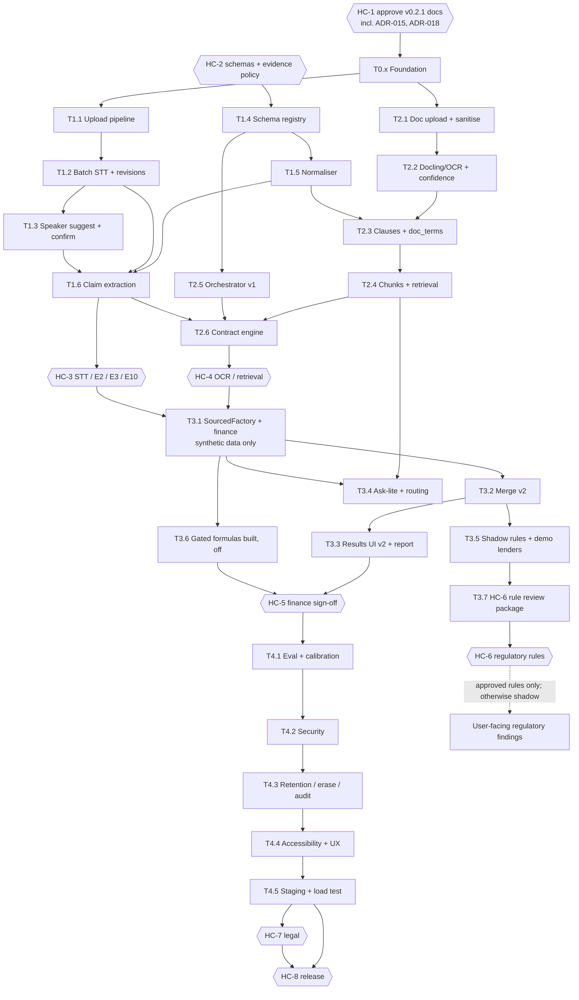

# SaidSigned — MVP Implementation Plan (v0.2.1, 2026-11-13)

> **HC-1: APPROVED** by the user (project owner) on 2026-11-13. HC-2…HC-8: **pending**. Phase 0 implementation is authorised; nothing beyond Phase 0. Implementation status is reported per task, never assumed.
>
> **v0.2.1 corrections** (from your review of v0.2):
> 1. HC-6 is restored in the graph, the checkpoint sequence and the roadmap.
> 2. Task count: v0.2 had **39** tasks. My earlier "40" was wrong. The genuinely missing task, **T3.7 (HC-6 rule review package)**, has been added, so the plan now has **40**.
> 3. ADR-015 and ADR-018 are in the HC-1 scope.
> 4. Consent and attestation are specified (§6).
> 5. The HC-5 finance gate is specified (§7).

## 1. Final MVP feature list
| # | Feature | Docs | Phase |
|---|---|---|---|
| M1 | Auth (register/login/refresh), sessions (upload mode) | 01, 11 | 0 |
| M2 | Versioned consent texts; customer consent record; customer **self-declared** recording attestation; revocation with processing cancellation; audit evidence (§6) | 01 §5, 11, 12 §B.1 | 0 |
| M3 | Events WS (progress/results), job queue with dedupe and cancellation, retry policy, error model, audit | 01, 11 | 0 |
| M4 | Recorded audio upload: magic-byte validation, limits, sha256 dedupe, normalisation, snippets, replace | 02 | 1 |
| M5 | Batch STT (Scribe v2): diarization, word timestamps and confidence, transcript revisions | 03 | 1 |
| M6 | Speaker auto-suggestion, **one-tap agent confirmation**, per-segment correction, stereo mapping | 03 §5, 10 | 1 |
| M7 | Structured loan claim extraction: anchored quotes, deterministic normaliser, consolidation, readiness | 04 | 1 |
| M8 | Document upload (PDF + photos), sanitising, versioning, page replace | 05 | 2 |
| M9 | Docling + OCR + confidence pass; clause segmentation; doc_terms; chunks | 05 | 2 |
| M10 | Hybrid retrieval (BM25 + vector + RRF) | 09 §3–4 | 2 |
| M11 | Contract verification engine (numeric, semantic, OCR gate) | 05 §7 | 2 |
| M12 | Orchestrator: gates, merge, CONFLICT evidence + integrity validators, versioned results, clarification questions | 08 | 2–3 |
| M13 | Finance engine, MVP set: reducing/flat EMI, fee, GST (assumption), net disbursement, total repayment/interest, amortisation; traces; `SourcedFactory`. **User-visible only after HC-5** (§7) | 06 | 3 |
| M14 | Results dashboard, evidence drawer, "updated because" | 10 | 2–3 |
| M15 | Customer report (PDF) with evidence, questions to ask, and the attestation shown as the customer's own statement | 10, 11 | 3 |
| M16 | Retention purge; session erase with tombstone and receipt; ownership enforcement | 11, 12 | 0/4 |
| M17 | Eval harness, calibration, security suite | 12 | 4 |

**MVP-limited:**
- L-a: basic Ask with finance routing. Finance answers are disabled until HC-5.
- L-b: selected RBI rules, **shadow until HC-6** approves each rule.
- L-c: ≤ 5 curated demo lenders, capped at UNCLEAR.
- L-d: Hindi/Hinglish declared only from E2 evidence.

## 2. Deferred features (designs preserved)
| ID | Feature |
|---|---|
| Later-L1 | Live microphone, realtime transcription, incremental extraction/verification (**P0-1**, ADR-015) |
| Later-L2 | Google Meet tab + mic capture |
| Later-L3 | Meet Media API spike |
| Later-L4 | Advanced RAG: reranking, query translation |
| Later-L5 | Automated lender data (RBI lists, scraping with permission) |
| Later-L6 | Expanded regulatory engine; APR, flat-to-effective, prepayment and penal exposure (HC-5 + HC-6) |
| Later-L7 | Insurance verification |
| Later-L8 | Second STT provider; advanced noise enhancement |
| Later-L9 | Lender-side dashboards |
| Not planned | Headless-browser bots; cellular call capture (research only) |

## 3. Dependency graph

- HC-5 unlocks user visibility of the MVP finance set only.
- HC-6 does not block HC-8. Without it, rules ship in shadow.
- HC-7 must be approved before HC-8 can permit real users.

## 4. Checkpoint sequence (HC-1 APPROVED 2026-11-13; HC-2…HC-8 PENDING)
| Order | ID | Trigger | Approves | Blocks |
|---|---|---|---|---|
| 1 | **HC-1 ✅ APPROVED 2026-11-13 (user)** | Before Phase 0 | v0.2.1 docs and this plan. Architecture and upload-first scope: ADR-001, ADR-002, **ADR-015** (upload-first MVP, P0-1 deferred), ADR-016, ADR-017, **ADR-018** (canonical owners, present in doc 14), plus Proposed ADR-006/012/014 as written. Accepted user decisions (ADR-003/007/008/009/010/011) are presented for confirmation | Phase 0 |
| 2 | **HC-2** | Before Phase 1 code | Claim schema, reason codes, CONFLICT evidence combinations, wording templates (docs 04, 08) | T1.4 onward |
| 3 | **HC-3** | Phase 1 exit | E2/E3/E10 results, languages, ADR-019 confirm-quote fallback, ElevenLabs config/pricing, fallback STT | T3.1 |
| 4 | **HC-4** | Phase 2 exit | OCR backend, thresholds, retrieval/NLI, embedding model (ADR-005/013) | T3.1 |
| 5 | **HC-5** | Phase 3 exit | Finance formulas, tolerances, GST assumption, synthetic results. Enables user visibility of the **MVP formula set only** (§7) | Phase 4; user-facing finance |
| 6 | **HC-6** | Phase 4, on T3.7 | Each curated regulatory rule and any user-facing regulatory finding. Until approved, **all rules stay in shadow** | User-facing regulatory findings only (not HC-8) |
| 7 | **HC-7** | Before any real user | Consent and attestation texts, privacy notice, retention, Q-13 policy, legal memo | Real-user use; HC-8 |
| 8 | **HC-8** | Phase 4 exit | MVP release readiness from the eval, security and UX reports | Release |

**HC-6 timing:** T3.7 is **completed in Phase 3** and produces the HC-6 review package. The **HC-6 approval checkpoint occurs in Phase 4**, once that package is ready. HC-6 **does not block HC-8**. Any rule HC-6 has not approved stays in **shadow mode** (never user-visible).

At each checkpoint the implementing agent presents:
1. progress so far
2. what was inspected or measured
3. the options considered
4. a recommendation
5. the exact decision to approve

It then waits. No approval is recorded unless you give it.

## 5. Task breakdown (dependency order) — **40 tasks** (Phase 0: 13, Phase 1: 8, Phase 2: 7, Phase 3: 7, Phase 4: 5)

### Phase 0 — Foundation (gate: HC-1)
| ID | Task | Files | Done when | Depends |
|---|---|---|---|---|
| T0.1 | Repo layout, compose (pgvector, MinIO), settings, logging | `infra/`, `core/{config,logging}.py` | Compose healthy | HC-1 ✅ |
| T0.2 | Migration 0001 (incl. `consent_texts`, `consents`, `jobs.cancel_requested_at`) | `alembic/versions/0001_*` | Up/down test | T0.1 |
| T0.3 | Error model + retry classifier | `core/{errors,retry}.py` | 4 error classes tested | T0.1 |
| T0.4 | Auth + WS tickets | `modules/auth/*` | Auth tests | T0.2 |
| T0.5 | Sessions, versioned consent texts, consent record, attestation, revocation with job cancellation, consent gate, audit entries (§6) | `modules/{sessions,consent}/*` | §6 tests pass | T0.4, T0.7, T0.9 |
| T0.6 | Idempotency middleware | `core/idempotency.py` | Replay/409 tests | T0.2 |
| T0.7 | Job queue: dedupe, `cancelled` status, cancellation checks, enqueue gate | `worker/*` | Concurrency, dedupe and cancel tests | T0.2, T0.3 |
| T0.8 | Event bus (outbox, NOTIFY, WS resume) | `modules/realtime/*` | Delivery ≤ 200 ms | T0.2 |
| T0.9 | Audit service | `modules/audit/*` | Actions recorded | T0.2 |
| T0.10 | Provider protocols + fakes | `llm/base.py`, `modules/stt/base.py` | Fakes usable | T0.1 |
| T0.11 | Frontend shell, API client with Idempotency-Key, events client, consent/attestation screens | `frontend/src/{app,lib,features/consent}` | Login → session → consent works | T0.5, T0.8 |
| T0.12 | CI (incl. feature-flag startup checks) | `.github/workflows/ci.yml` | Green | all |
| T0.13 | Start eval datasets; draft consent/attestation texts (en/hi) for HC-7 | `eval/datasets/*`, `backend/data/consent_texts/*` | 10 agreements drafted; texts drafted (not approved) | — |

#### Phase 0 implementation status (updated 2026-11-14). All 13 tasks are implemented. Verification has specific limitations, including no real-browser testing of the frontend shell and no independently verified GitHub Actions run on `main`; these are listed in `MVP_TASK_STATUS.md`, which holds the Phase 0 exit report
| Task | Status | Evidence |
|---|---|---|
| T0.1 | ✅ | Q-16 resolved (MinIO built from source); `make up`: all services healthy; `/readyz` all `ok`; SSE-S3 put/head/presign/delete smoke test |
| T0.2 | ✅ | `0001_foundation`; upgrade→downgrade→upgrade test |
| T0.3 | ✅ | `core/errors.py`, `core/retry.py`; unit tests for all 4 classes |
| T0.4 | ✅ | register/login/refresh rotation + reuse detection/logout/ws-ticket tests |
| T0.5 | ✅ | consent + attestation + revocation + cancellation + gate (test-only route) + audit tests |
| T0.6 | ✅ | replay, 409 conflict, 400 missing, 409 in-progress, concurrency tests |
| T0.7 | ✅ | coalescing dedupe, lease reclaim, retry per class, cancellation-commits-nothing tests |
| T0.8 | ✅ | WS delivery < 200 ms after consent commit, resume with `since`, ticket single use |
| T0.9 | ✅ | audit rows asserted; append-only trigger test |
| T0.10 | ✅ interfaces + fakes only | `llm/base.py`, `modules/stt/base.py`; no provider implemented |
| T0.11 | ✅ skeleton | login/register, sessions, consent+attestation screens, events client; vitest; API-level smoke via Vite proxy (no browser E2E yet) |
| T0.12 | ✅ | `make ci` exit 0 with 55/55 backend tests (0 skipped); `REQUIRE_DB=1` makes CI fail rather than skip; eval-dataset check job added. GitHub run: see `MVP_TASK_STATUS.md` |
| T0.13 | ✅ | 10 synthetic agreements (`eval/datasets/agreements`, digital PDF + `terms.yaml`, all 6 traps, 101 terms checked); DRAFT consent/attestation texts (HC-7 pending). Scans/photos are manual, due before E5 |

### Phase 1 — Upload, STT, speakers, claims (gates: HC-2 at start, HC-3 at exit)
| ID | Task | Done when | Depends |
|---|---|---|---|
| T1.1 | Recording upload pipeline (doc 02) | Format, dedupe, replace and consent-gate tests | T0.x |
| T1.2 | ElevenLabs batch adapter + revisions (doc 03 §6) | Cassette tests; atomic rewrite; cancellation honoured | T1.1, API key provided by you |
| T1.3 | Speaker suggestion + confirmation API + UI | Confirm, swap, reassign; audited | T1.2 |
| T1.4 | Schema registry (doc 08 §3) | `REASON_STATUS` complete; validators tested | HC-2 |
| T1.5 | Normaliser (doc 04 §6) | ≥ 300-case table | T1.4 |
| T1.6 | Claim extraction + anchors + consolidation | Anchor property test; idempotent re-run | T1.2, T1.5, ADR-004 |
| T1.7 | Claims UI, transcript view, snippet playback | E2E with fakes | T1.3, T1.6 |
| T1.8 | Experiments E2, E3, E10 + LLM selection eval | Reports in `eval/reports/` | T1.2, T1.6 |

### Phase 2 — Documents & contract verification (gate: HC-4)
| ID | Task | Done when | Depends |
|---|---|---|---|
| T2.1 | Document upload, sanitise, versioning, page replace | Security fixtures | T0.x |
| T2.2 | Render, photo pre-process, Docling/OCR, confidence pass | E5 run; bbox normalisation test | T2.1 |
| T2.3 | Clause segmentation + doc_terms | Boundary F1 reported | T2.2, T1.5 |
| T2.4 | Chunks, embeddings, hybrid retrieval | E6 retrieval metrics | T2.3, ADR-005 |
| T2.5 | Orchestrator v1 (gates, merge, validators, versioning) | Property tests | T1.4 |
| T2.6 | Contract engine (formula-dependent comparisons return `calculation_not_enabled` until HC-5) | 200-pair confusion matrix | T2.4, T2.5, T1.6 |
| T2.7 | Results dashboard v1 + evidence drawer | bbox + snippet E2E | T2.6 |

### Phase 3 — Finance, orchestration, reporting (gate: HC-5 at exit; produces the HC-6 package)
| ID | Task | Done when | Depends |
|---|---|---|---|
| T3.1 | `SourcedFactory`, MVP formulas, traces, tolerance table, `features.yaml` finance flags + startup check. **Synthetic data only; user visibility off** | Golden 100%; `UnvalidatedInputError`; flag tests | HC-3, HC-4 |
| T3.2 | Merge v2: primary comparison, C-CALC-DOC, `internal_inconsistency`, severity (all finance-derived output behind the visibility flag) | Merge tests with the flag on/off | T3.1, T2.5 |
| T3.3 | Results UI v2 + PDF report (attestation worded as the customer's statement) | Report snapshot; wording tests | T3.2 |
| T3.4 | Ask-lite with routing + citation validator (finance route disabled until HC-5) | Routing ≥ 95%; 0 invalid citations | T2.4, T3.1 |
| T3.5 | Shadow rules + demo lender data | Shadow never visible (test) | T3.2 |
| T3.6 | Gated formulas (APR, flat-to-effective, prepayment, penal) built and tested, **off for the whole MVP** | Flag tests; E7 shadow report | T3.1 |
| **T3.7** | **HC-6 rule review package (new in v0.2.1):** for each MVP rule, fill the verbatim `quote` from the primary source, applicability lists, en/hi `explain_*` drafts, effective dates, source URLs and shadow precision/recall on fixtures. Package goes to a qualified reviewer. Nothing is enabled | Package complete in Phase 3; every rule still `enabled:false`. The HC-6 decision itself happens in Phase 4 | T3.5 |

### Phase 4 — Evaluation, security, release (gates: HC-6 review, HC-7, HC-8)
| ID | Task | Done when |
|---|---|---|
| T4.1 | Full eval, threshold calibration, perturbation suite | Reports for every doc 12 A.3 metric |
| T4.2 | Security controls + tests; rate limits; CSP | Security suite passes |
| T4.3 | Retention purge, erase + receipts, audit completeness (incl. consent/attestation/cancellation events) | Tombstone and audit tests |
| T4.4 | Accessibility, Hindi copy review, UX test (3–5 users) | Findings addressed |
| T4.5 | Staging deploy, runbook, load test (20 concurrent uploads) | Staging live |

## 6. Consent & recording attestation — implementation specification (canonical: doc 01 §5)
| Element | Implementation |
|---|---|
| Versioned text | `consent_texts` (kind `processing` / `attestation`, version, locale en/hi, body, `body_sha256`, effective dates). Immutable; changes create new versions. Texts drafted in T0.13; **real-user use needs HC-7** |
| Customer consent | Records `consent_text_id`, version and hash of the exact text shown, locale, server `granted_at`, actor, user-agent hash |
| Customer attestation | **The customer's self-declaration**: `i_was_party` (required true), `agent_informed` (yes / no / unsure, as declared), optional date and source. Stored with `attested_at` and the attestation text version/hash. **It is not independent proof that the agent consented or was informed, and SaidSigned does not verify it.** UI, report and export phrase it as "The customer states … (not independently verified)". A string test rejects wording that presents it as agent consent |
| Policy for `agent_informed ≠ yes` | Q-13, legal, HC-7. Until then: store, warn, and mark the report as a customer statement |
| Revocation | One transaction: `revoked_at`; session `failed(consent_revoked)`; queued jobs → `cancelled`; running jobs → `cancel_requested_at`. Handlers check at step boundaries, roll back and end `cancelled`. New enqueues are refused. In-flight provider results are discarded. Erasure is offered |
| Gate | Upload, extraction, verification, Q&A and report return `403 consent_required` without active consent + attestation |
| Audit evidence | `consent.grant`, `attestation.submit`, `consent.revoke`, `jobs.cancelled`, `job.cancel_observed`, with ids, text versions and hashes only. Kept in the erasure tombstone |
| Tests | Gate; version/hash stored; revocation cancels queued and running jobs with no committed outputs; enqueue refused after revocation; audit rows present; wording test |

## 7. HC-5 finance gate — what is allowed before approval (canonical: doc 06 §4a)
| | Before HC-5 approval | After HC-5 approval (recorded) |
|---|---|---|
| **Implement + test** | All formulas, including gated ones; `SourcedFactory`; traces; tolerances. Unit, golden, property and E7 tests on **synthetic or team data** | — |
| **MVP set** (reducing/flat EMI, fee, GST with assumption label, net disbursement, total repayment, total interest, amortisation) | **Hidden.** Finance engine → `NOT_VERIFIED(calculation_not_enabled)`. No finance figures, "consistent" notes, `internal_inconsistency`, C-CALC-DOC verdicts or formula-based conversions in the UI, report or Ask. Internal preview only in synthetic dev/staging (`finance.preview_internal`, refused where real users exist) | **Visible** via `finance.mvp_formulas_user_visible=true` (startup check requires the approval record) |
| **Gated set** (APR, flat-to-effective, prepayment, penal) | Disabled; shadow traces only | **Still disabled for the whole MVP.** HC-5 approves the methods for later. Exposure is Later-L6; prepayment and penal also need HC-6 |
| **Not gated** | Like-for-like contract comparisons (spoken "2%" vs document "2%"; INR vs INR) | Same |

## 8. Decisions requiring your approval
| ID | Decision | Recommendation | When |
|---|---|---|---|
| D1 | **HC-1:** approve the v0.2.1 docs and this plan, incl. ADR-001, 002, **015**, 016, 017, **018** and Proposed 006/012/014 | — | ✅ **APPROVED 2026-11-13** |
| D2 | **HC-2:** claim schema, reason codes, CONFLICT evidence combinations, wording | Approve after reviewing docs 04/08 | Before Phase 1 code |
| D3 | ADR-019 confirm-quote fallback | Approve only if E3 shows weak or no confidences | HC-3 |
| D4 | ADR-004 LLM provider | Decide from the Phase 1 eval | Phase 1 |
| D5 | ADR-005 / ADR-013 embeddings and OCR | Decide from E5/E6 | HC-4 |
| D6 | **HC-5:** finance formulas, tolerances, GST 18% assumption, MVP-set visibility | Finance-literate reviewer | Phase 3 exit |
| D7 | **HC-6:** per-rule approval of the curated regulatory rules (T3.7 package), and whether any approved rule becomes visible in the MVP or waits for Later-L6 | Qualified legal/compliance reviewer | Phase 4 |
| D8 | **HC-7:** consent/attestation texts, privacy notice, retention (Q-11/Q-14), Q-13 policy | Legal advice | Before real users |
| D9 | Q-4 hosting region / residency | India region if feasible | HC-1 |
| D10 | Q-5 / Q-12 device, team size, deadline | Your input | HC-1 |
| D11 | Q-1 PPT / UI designs | Your input | HC-1 |
| D12 | Q-10 malware scanning | Optional ClamAV in Phase 4 | HC-1 |
| D13 | **HC-8:** MVP release readiness | From reports | Phase 4 exit |

## 9. Technical risks
| Risk | Impact | Mitigation | Evidence needed |
|---|---|---|---|
| Hinglish numeric errors | False or missed conflicts | Gates, keyterms, normaliser, confirm-quote (proposed), "beta" labelling | E2 |
| No usable batch word confidences | ASR gate blocks most CONFLICTs | ADR-019 fallback | E3 |
| Diarization errors on mono recordings | Wrong attribution | One-tap confirmation, per-segment fix | E10 |
| Phone-photo OCR on numbers | False conflicts | OCR gate, page replace, UNCLEAR | E5 |
| Semantic NLI precision | False accusations | Two-model agreement, else UNCLEAR | E6 |
| Finance shown before validation | Misleading figures | HC-5 visibility flag + startup check | Flag tests |
| Attestation misread as agent consent | Legal/trust harm | Wording rules + string test; HC-7 | Wording test, legal memo |
| LLM provider not chosen | Phase 1 delay | Provider-agnostic interface; early eval | Phase 1 eval |
| Recording legality / agent's data | Product cannot launch | HC-7 before real users | Legal memo |
| ElevenLabs pricing/availability | Cost/outage | Fallback decision at HC-3 | Pricing check |
| Unverified regulatory details | Misleading output | Shadow until HC-6, per rule | T3.7 + HC-6 |
| Scope drift back to live | MVP delay | ADR-015; Later-L1 after HC-8 | — |

## 10. Evaluation experiments
| ID | Experiment | Phase | Gate |
|---|---|---|---|
| E2 | Hinglish/English WER + numeric-token accuracy (batch) | 1 | HC-3 |
| E3 | Batch word-confidence availability and quality | 1 | HC-3 |
| E10 | Diarization + auto-role accuracy; confirmation UX | 1 | HC-3 |
| E5 | OCR backends on PDF, scan and photo; confidence; time per page | 2 | HC-4 |
| E6 | Retrieval + NLI/LLM-judge precision | 2 | HC-4 |
| E7 | APR method vs the RBI KFS illustration (shadow) | 3 | HC-5 (for later enablement) |
| E9 | Denoising on uploads (optional) | 1–4 | ADR-012 |
| E1, E4, E8 | Realtime, tab capture, Meet API | Later-L1/L2/L3 | — |
